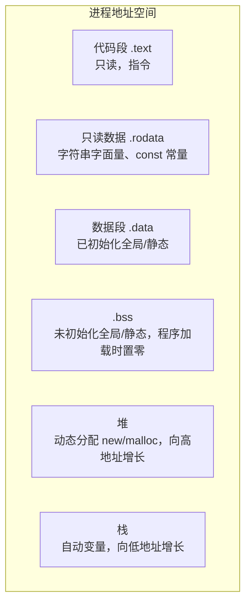
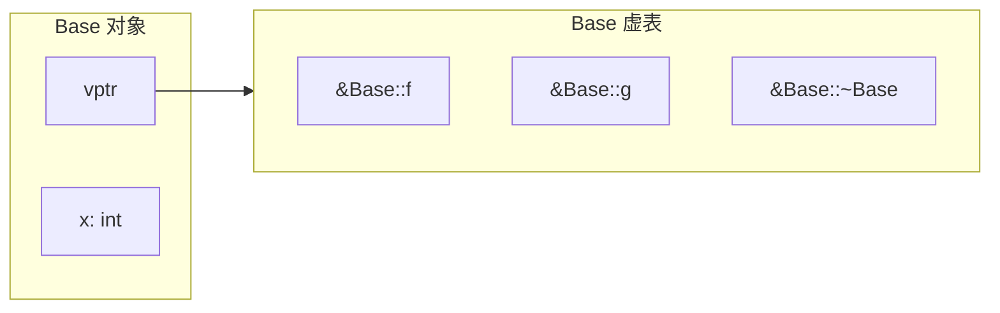
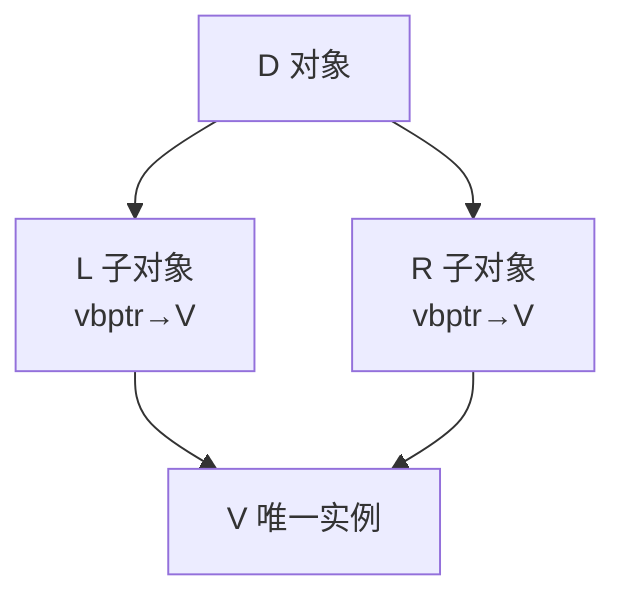

# C++ 内存模型与对象模型

> 本文件双线展开：**对象模型**（单一对象的存储布局、虚机制、继承布局、对齐）与 **内存模型**（存储期、地址空间、内存序、`volatile`、内存布局控制）。两者共同回答“一个 C++ 对象在内存里到底是什么样、如何被访问”。内容严格限定在 C++11 及之前标准。

---

## 目录

1. 内存布局总览：存储期与地址空间
2. 对象模型基础：数据成员布局与对齐
3. 对齐（Alignment）与 `alignof` / `alignas`
4. 指针与对象大小的语义
5. 虚表机制与多态对象布局
6. 继承布局：单继承、多继承、虚继承
7. `this` 指针与成员访问
8. 存储期与对象生命周期（C++11 细化）
9. 内存序（memory order）与原子操作（C++11）
10. `volatile` 的定位与边界
11. 内存布局控制：`sizeof`/`offsetof`/POD/trivially
12. 内存管理机制：栈、堆、静态区
13. 常见布局与内存问题
14. 与底层/工具链的衔接

---

## 1. 内存布局总览：存储期与地址空间

### 1.1 四大存储区



| 区 | 分配机制 | 生命周期 | 管理 |
|---|---|---|---|
| 代码段/只读数据 | 程序加载 | 整个进程 | 系统 |
| 数据段 / BSS | 程序加载 | 整个进程 | 系统（BSS 零初始化） |
| 堆 | `new`/`delete`、`malloc`/`free` | 手动 | 运行时内存分配器 |
| 栈 | 函数调用 | 调用帧生存期 | 编译器（随作用域） |

### 1.2 地址空间方向

- 栈向**低地址**增长，堆向**高地址**增长（常见实现，并非标准规定）。
- 地址空间大小受体系结构/操作系统限制（如 64 位地址空间、栈大小 ulimit）。

---

## 2. 对象模型基础：数据成员布局与对齐

### 2.1 布局规则

- 非静态数据成员按**声明顺序**分配（标准保证：后声明者地址更高）。
- 中间插入满足对齐所需的**填充（padding）**字节。
- 类对象大小 = 对齐后各成员之和 + 尾部填充 + （若有虚函数）vptr。
- 静态成员、成员函数**不占用**单个对象存储。

### 2.2 布局示例

```cpp
struct A {
    char  c;      // 1 字节
    int   i;      // 4 字节，需 4 字节对齐
    short s;      // 2 字节
};
// 布局: c(1) + padding(3) + i(4) + s(2) + tail_padding(2) = 12 字节
// alignof(A) == 4
```

```cpp
struct B {        // 若按成员声明顺序重排
    int   i;      // 4
    char  c;      // 1
    short s;      // 2，需 2 对齐 → 布局: i(4)+c(1)+padding(1)+s(2)=8 字节
};
```

> 同一组数据，**排列顺序影响对象大小**（上例 A=12、B=8）。把大对齐成员前置可减少填充。

### 2.3 布局与 ABI

- 布局由编译器的 **ABI（应用二进制接口）** 决定，与 ISO 标准允许实现差异。跨编译器/跨语言互操作依赖 ABI 约定（Itanium C++ ABI 为 Linux/Clang/GCC 通用，MSVC 使用自己的 ABI）。
- 跨 DDL/SO 边界传递 C++ 类需保证**同一编译器、同一 ABI**，否则布局不兼容。

---

## 3. 对齐（Alignment）与 `alignof` / `alignas`

### 3.1 对齐概念

每种对象类型有一个对齐要求（alignment）：对象起始地址必须是该对齐值的整数倍。对齐保证硬件高效（原子）访问，未对齐访问可能性能下降甚至崩溃（某些架构）。

- `alignof(T)`：查询类型 T 的对齐要求（C++11）。
- `alignas(N)`：指定变量/类型的对齐（C++11）。

```cpp
alignof(int);                 // 通常 4
struct alignas(16) Vec4 { float x,y,z,w; };   // 强制 16 字节对齐
alignas(64) double buf[8];    // 64 字节对齐，利于 SIMD/缓存行
```

### 3.2 分配器的对齐

- C++11 中，普通 `new` 返回的对齐满足所有内建类型的对齐。
- 需要超对齐（如 SIMD）时，C++11 可用 `std::aligned_storage` 或平台 API（`posix_memalign`/`_aligned_malloc`）。

---

## 4. 指针与对象大小的语义

### 4.1 `sizeof`

- `sizeof(T)`：类型对象大小（含填充），编译期常量。
- `sizeof(expr)`：表达式结果类型的大小，不求值表达式。
- `sizeof` 永远返回 **char 单位**；`sizeof(char)==1` 由标准保证。
- 空类 `sizeof` 为 1（C++11 空基类优化 EBO 可折叠基类）。

### 4.2 空类与空基类优化（EBO）

```cpp
struct Empty {};
struct WithEmpty { Empty e; int x; };   // sizeof 可能为 8（e 占 1 + 填充）
struct Derived : Empty { int x; };      // EBO：空基类不占空间 → sizeof 通常为 4
```

空基类优化使“空类型作为基类”不额外占空间，是现代分配器/标注类型的实现基础。

### 4.3 `std::aligned_storage`（C++11）

`std::aligned_storage<Len,Align>::type` 提供对齐且足够大的**未初始化原始存储**，用于实现内存池、就地构造（placement new）：

```cpp
typedef typename std::aligned_storage<sizeof(T), alignof(T)>::type Storage;
Storage buf;
T* p = new (&buf) T(args);   // placement new：在 buf 上构造
p->~T();                     // 手工析构
```

---

## 5. 虚表机制与多态对象布局

### 5.1 含虚函数的对象

```cpp
class Base {
public:
    virtual void f() {}
    virtual void g() {}
    int x;
};
```

- 对象头部隐含 **vptr**（虚表指针，通常位于偏移 0，具体由 ABI 决定）。
- vptr 指向该对象**动态类型**的虚表（vtable），虚表为函数指针数组。
- 大小 = sizeof(vptr) + 数据成员 + 填充。



### 5.2 派生类虚表

- 派生类若覆盖虚函数，其虚表对应槽位替换为**派生类版本**地址。
- 新增虚函数追加到虚表尾部。
- 对象 vptr 在构造过程中被逐步更新：基类构造阶段指向基类虚表，进入派生类构造后指向派生类虚表。**构造/析构期间的虚调用分派到当前正在构造的类**（不是最终类型）。

### 5.3 虚调用的代价

- 取 vptr → 索引虚表 → 间接调用：比直接调用多 1~2 次内存访问。
- 现代编译器对 `final` 类、常量传播、去虚化优化可消除部分虚调用。

---

## 6. 继承布局：单继承、多继承、虚继承

### 6.1 单继承

派生对象 = 基类子对象（含其 vptr）+ 自身数据成员，连续排布。派生类与基类地址在多数情况下相同（基类位于对象头部时 `this` 不需调整）。

### 6.2 多继承

```cpp
class A { virtual void a(); int x; };
class B { virtual void b(); int y; };
class D : public A, public B { int z; };
```

- 对象包含 **A 子对象** 与 **B 子对象** 两个基类子对象，各带 vptr。
- 布局：`[A 部分][B 部分][D 新增成员]`。
- 从 `D*` 转 `B*` 需**调整偏移**（`this` 后移）。
- 多基类导致虚表为多张，B 子对象的虚表会与独立 B 对象布局对齐以便正确转指针。

### 6.3 虚继承（菱形）

```cpp
struct V { int v; };
struct L : virtual V { int l; };
struct R : virtual V { int r; };
struct D : L, R { int d; };
```

- 非虚继承：`D` 含两份 `V`（`L` 内一份 + `R` 内一份），存在**二义性**与状态重复。
- 虚继承：`D` 中只有**一份共享的 `V` 子对象**，由 `L`/`R` 通过**虚基类指针（vbptr）**或编译器偏移表定位。



- 虚基类子对象通常排在对象尾部，访问其成员需经额外偏移计算，**访问更慢、布局更复杂**。
- 仅当确有菱形共享需求时使用；多数工程以组合替代深继承层级。

---

## 7. `this` 指针与成员访问

- 非静态成员函数隐式接收 `this`（指向调用对象）。
- `this` 不是对象成员，不占对象大小。
- 多继承/虚继承下访问不同基类成员时，`this` 会被**调整偏移**。
- 静态成员函数无 `this`，只能访问静态成员。
- `const` 成员函数中 `this` 为 `const T*`。

---

## 8. 存储期与对象生命周期（C++11 细化）

| 存储期 | 对象 | 生命周期起止 |
|---|---|---|
| 自动 | 局部变量、函数参数 | 进入作用域 → 离开作用域（析构） |
| 静态 | 全局/静态/命名空间成员 | 程序启动前 → 程序结束 |
| 线程（C++11 `thread_local`） | 线程局部 | 线程启动 → 线程结束 |
| 动态 | `new` 对象 | `new` 完成构造 → `delete` 执行析构 |

### 8.1 对象生命周期与 `const`

- `const` 对象生命周期内不可修改（`const_cast` 去 `const` 修改是 UB，除非对象本身非 `const`）。
- 临时对象（纯右值）在所在完整表达式的结尾销毁（右值引用延长例外，见语法章节）。

### 8.2 静态初始化顺序问题（经典陷阱）

跨编译单元的非局部静态对象初始化顺序**未定义**。对策（C++11）：

```cpp
T& get_singleton() {
    static T inst;   // 局部静态：首次进入时线程安全地初始化一次（magic static）
    return inst;
}
```

C++11 保证**局部静态变量**的初始化是线程安全的（编译器生成 guard 变量），是替代“全局对象直接初始化”的最佳实践。

---

## 9. 内存序（memory order）与原子操作（C++11）

### 9.1 原子类型与内存序的意义

`<atomic>` 提供原子类型 `std::atomic<T>`。原子操作不仅保证“单个操作不被撕裂”，还定义**操作之间的可见性与排序关系**——即内存模型中的**内存序（memory order）**。

```cpp
std::atomic<int> flag{0};
```

### 9.2 六种内存序（`std::memory_order`）

| 枚举值 | 语义强度 | 用途 |
|---|---|---|
| `memory_order_relaxed` | 仅原子性，无排序/可见性保证 | 计数器、无依赖标记 |
| `memory_order_consume` | 数据依赖链上的传播（实现常退化为 acquire） | 指针发布（少用） |
| `memory_order_acquire` | 之后读操作可见此前同 release 的写 | 读锁、消费发布 |
| `memory_order_release` | 之前的写在释放点后对其他线程可见 | 写锁、发布 |
| `memory_order_acq_rel` | acquire+release | 读改写（RMW） |
| `memory_order_seq_cst` | 全序（默认） | 需全局一致序的同步 |

### 9.3 内存模型的本质

C++11 内存模型把多线程程序的可能行为形式化，避免数据竞争（data race）。**同一内存位置被两个线程同时访问、且至少一方为写、且无同步关系 → 数据竞争 → 未定义行为**。

正确同步手段：

```cpp
std::atomic<bool> ready{false};
std::string payload;

// 生产者
payload = "data";                 // 写普通对象
ready.store(true, std::memory_order_release);   // 发布

// 消费者
while (!ready.load(std::memory_order_acquire)) {}  // 获取
// 此时读取 payload 保证可见（release-acquire 同步）
```

### 9.4 无锁编程边界

- 无锁（lock-free）追求避免内核级互斥，但正确性极难保证，须精确推演内存序。
- 优先使用 `<mutex>`/条件变量/`<future>`；仅在真实性能瓶颈且充分验证时才下沉到原子+内存序。

---

## 10. `volatile` 的定位与边界

- `volatile` 告知编译器：该对象可能被“编译器不可见”的方式修改（硬件寄存器、信号处理、多线程外设备），**禁止对该对象的读写做优化合并/缓存**。
- **`volatile` 不提供任何线程同步**：它不是原子操作，不建立内存序，不能用于多线程互斥。多线程正确同步用 `std::atomic` 与 `std::mutex`。
- 典型正确用途：内存映射 I/O、信号处理中的标志、嵌入式寄存器。

---

## 11. 内存布局控制：POD / trivially copyable

### 11.1 相关概念（C++11）

| 概念 | 含义 |
|---|---|
| 平凡可拷贝（trivially copyable） | 可用 `memcpy` 安全复制，复制后与源等价；含平凡拷贝/移动构造、赋值、析构，无虚函数/虚基类 |
| 标准布局（standard layout） | 布局可预测（无虚、访问控制一致、单继承等） |
| POD | 平凡 + 标准布局，可安全与 C 互操作 |

```cpp
static_assert(std::is_trivially_copyable<MyType>::value, "...");
```

- 平凡类型可用 `memcpy`/`memmove` 复制，是 C 互操作、序列化、缓冲区拷贝的前提。
- 引入虚函数、虚继承、引用成员、非平凡构造会打破这些保证。

### 11.2 控制布局的工具

- 成员声明顺序决定成员地址（标准保证相对顺序）。
- `alignas` 控制对齐。
- 位域（bit-field）：紧凑存储整数片段，布局由实现定义。

---

## 12. 内存管理机制：栈、堆、静态区

### 12.1 栈帧（stack frame）

函数调用压入栈帧：返回地址、保存的寄存器、局部变量、可能的参数区。递归深度受栈容量限制（过深 → 栈溢出）。

### 12.2 堆分配器

- `new`/`delete`：走 C++ 运行时分配器（最终调 `malloc`/平台 API，可自定义 `operator new`）。
- 堆碎片化、分配延迟、缓存局部性差是性能隐患；优先容器与池化。

### 12.3 静态区与常量折叠

- 字符串字面量通常存只读区，相同内容可能被合并（string pooling）。
- `constexpr` 常量可能被折叠进代码/只读数据。

---

## 13. 常见布局与内存问题

| 问题 | 成因 | 对策 |
|---|---|---|
| 栈溢出 | 大局部对象/深递归 | 栈上避免大数组，用容器/堆 |
| 内存泄漏 | `new` 无 `delete` | RAII/智能指针 |
| 悬垂指针 | 释放后仍访问 | 智能指针、生命周期管理 |
| 双重释放 | 浅拷贝/重复 delete | 移动语义、智能指针 |
| 对齐不满足 | 自定义 allocator 未对齐 | `alignas`/`aligned_storage` |
| 填充浪费 | 成员顺序不佳 | 大对齐成员前置 |
| ABI 不兼容 | 跨编译器传递类 | 统一 ABI/C 接口 |
| 数据竞争 | 多线程无同步 | 原子/互斥（见并发章节） |
| 未初始化读 | 自动变量未初始化 | 统一初始化 `{}` |

---

## 14. 与底层/工具链的衔接

- 查看对象布局：GCC/Clang `-fdump-layout`、`pahole`、GDB `ptype`。
- 查看虚表：GDB 中打印对象地址查看 vptr 指向。
- ABI 工具：`abi::__cxa_demangle`、`typeid`。
- 反汇编：`objdump -d`/`nm` 查看符号与布局佐证。

> 深入编译/链接期视角见 `C++生态及工具链/编译链接原理与静态库动态库.md`。

---

> **进入下一章前自检**：能否画出含虚函数的派生类对象布局？解释 padding 与 alignas 作用？说明 release-acquire 内存序如何同步数据？下一步请阅读 `STL六大组件全详解.md`。
