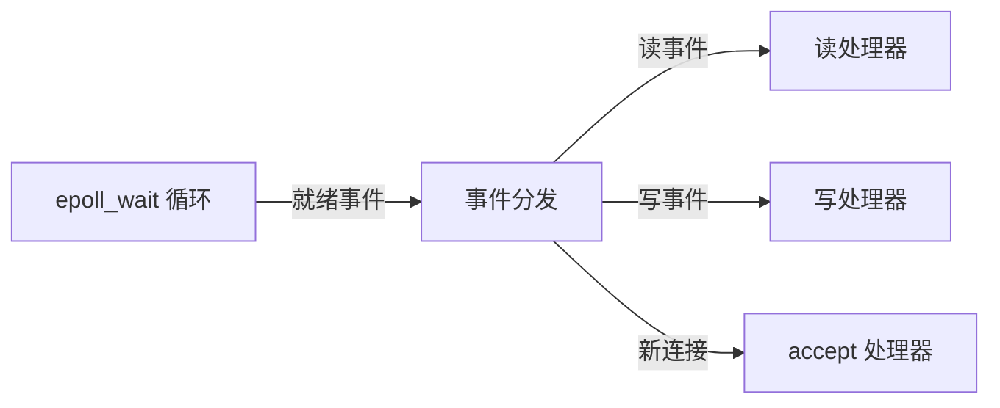

# C++ 网络编程

> 网络编程是 C++ 服务端/客户端开发的支柱领域。本文件覆盖套接字（socket）编程的完整体系：TCP/UDP、阻塞/非阻塞、I/O 多路复用（select/poll/epoll）、事件驱动与 Reactor 模型、协议设计、以及工程化要点。网络 API 属操作系统层面（POSIX / Winsock），C++11 标准库不提供网络，故本文以系统调用 + C++11 封装为主线，严格不使用 C++14+ 特性。

---

## 目录

1. 网络编程基础：分层模型与关键概念
2. 套接字基础：创建、绑定、监听、连接
3. TCP 编程：服务端与客户端完整流程
4. UDP 编程：无连接通信
5. 阻塞 vs 非阻塞 vs 异步
6. I/O 多路复用：select / poll / epoll
7. 事件驱动与 Reactor 模型
8. 内存、缓冲区与粘包拆包
9. 协议设计基础
10. 超时、错误处理与优雅关闭
11. 多线程/多进程网络服务模型
12. Windows（Winsock）与跨平台要点
13. C++11 风格的网络封装
14. 性能与安全要点

---

## 1. 网络编程基础

### 1.1 分层模型（TCP/IP 四层）


- **传输层**：TCP（可靠、面向连接、字节流）、UDP（不可靠、无连接、数据报）。
- **套接字（socket）**：应用层与传输层之间的编程接口抽象，标识一个通信端点（IP + 端口）。

### 1.2 关键地址结构（POSIX）

```cpp
#include <sys/socket.h>
#include <netinet/in.h>
#include <arpa/inet.h>

struct sockaddr_in addr;
addr.sin_family = AF_INET;              // IPv4
addr.sin_port   = htons(8080);          // 端口，主机序→网络序
addr.sin_addr.s_addr = inet_addr("127.0.0.1");  // 或 htonl(INADDR_ANY)
```

- **字节序**：网络字节序为大端（big-endian）；主机序转网络序用 `htons/htonl`，反向用 `ntohs/ntohl`。
- `INADDR_ANY`：绑定本机所有地址。

### 1.3 三次握手与四次挥手

- TCP 建立：SYN → SYN+ACK → ACK（三次握手）。
- TCP 关闭：FIN → ACK → FIN → ACK（四次挥手），还有 TIME_WAIT 状态处理。

---

## 2. 套接字基础

### 2.1 创建

```cpp
int fd = socket(AF_INET, SOCK_STREAM, 0);   // TCP：SOCK_STREAM
int fd = socket(AF_INET, SOCK_DGRAM,  0);   // UDP：SOCK_DGRAM
if (fd < 0) { /* 错误 */ }
```

### 2.2 绑定、监听、连接（TCP 服务端骨架）

```cpp
int fd = socket(AF_INET, SOCK_STREAM, 0);

int opt = 1;
setsockopt(fd, SOL_SOCKET, SO_REUSEADDR, &opt, sizeof(opt));  // 允许快速重用端口

sockaddr_in addr{};
addr.sin_family = AF_INET;
addr.sin_addr.s_addr = htonl(INADDR_ANY);
addr.sin_port = htons(8080);

bind(fd, (sockaddr*)&addr, sizeof(addr));   // 绑定
listen(fd, SOMAXCONN);                       // 进入监听（backlog 队列长度）

while (true) {
    sockaddr_in peer{};
    socklen_t len = sizeof(peer);
    int conn = accept(fd, (sockaddr*)&peer, &len);   // 接受连接，阻塞
    // 处理 conn ...
}
```

### 2.3 客户端连接

```cpp
int fd = socket(AF_INET, SOCK_STREAM, 0);
sockaddr_in server{};
server.sin_family = AF_INET;
server.sin_port = htons(8080);
inet_pton(AF_INET, "127.0.0.1", &server.sin_addr);

if (connect(fd, (sockaddr*)&server, sizeof(server)) < 0) { /* 失败 */ }
```

### 2.4 读写

```cpp
// 发送
send(conn, buf, n, 0);              // TCP 可能部分发送，需循环
ssize_t n = recv(conn, buf, sizeof(buf), 0);   // 返回 0=对端关闭, -1=错误

// UDP
sendto(fd, buf, n, 0, (sockaddr*)&peer, sizeof(peer));
recvfrom(fd, buf, sizeof(buf), 0, (sockaddr*)&peer, &len);
```

### 2.5 关闭

```cpp
close(fd);        // 关闭描述符
shutdown(fd, SHUT_WR);   // 半关闭：只停止发送，仍可接收
```

---

## 3. TCP 编程：完整流程

### 3.1 回显服务端（阻塞、单连接、C++11 风格封装）

```cpp
#include <sys/socket.h>
#include <netinet/in.h>
#include <unistd.h>
#include <cstring>
#include <string>
#include <thread>
#include <vector>

class TcpServer {
public:
    explicit TcpServer(uint16_t port) {
        fd_ = socket(AF_INET, SOCK_STREAM, 0);
        int opt = 1;
        setsockopt(fd_, SOL_SOCKET, SO_REUSEADDR, &opt, sizeof(opt));
        sockaddr_in a{};
        a.sin_family = AF_INET;
        a.sin_addr.s_addr = htonl(INADDR_ANY);
        a.sin_port = htons(port);
        bind(fd_, (sockaddr*)&a, sizeof(a));
        listen(fd_, SOMAXCONN);
    }
    void run() {
        while (true) {
            sockaddr_in peer{};
            socklen_t len = sizeof(peer);
            int c = accept(fd_, (sockaddr*)&peer, &len);
            if (c < 0) continue;
            // 每个连接一个线程处理（简单但线程开销大，生产用线程池/事件模型）
            std::thread(&TcpServer::handle, this, c).detach();
        }
    }
    ~TcpServer() { if (fd_ >= 0) close(fd_); }
private:
    void handle(int c) {
        char buf[4096];
        while (true) {
            ssize_t n = recv(c, buf, sizeof(buf), 0);
            if (n <= 0) break;          // 0=关闭，<0=错误
            std::string msg(buf, n);
            // 处理业务（协议解析见第9章）
            send_all(c, msg);           // 回显
        }
        close(c);
    }
    static void send_all(int c, const std::string& s) {
        size_t sent = 0;
        while (sent < s.size()) {       // TCP 可能部分发送，须循环
            ssize_t n = send(c, s.data() + sent, s.size() - sent, 0);
            if (n <= 0) break;
            sent += (size_t)n;
        }
    }
    int fd_;
};
```

### 3.2 TCP 特性带来的工程要点

- **字节流无边界**：TCP 不保留消息边界 → 需要**粘包/拆包**处理（见第 8 章）。
- **部分收发**：`send`/`recv` 可能只处理部分数据，必须循环直到完成（`send_all`/`recv_full`）。
- **阻塞语义**：阻塞模式下，读在无数据时挂起；写在不满足窗口时挂起。
- **对端关闭检测**：`recv` 返回 0 表示对端正常关闭（FIN）。

---

## 4. UDP 编程：无连接通信

```cpp
// 服务端
int fd = socket(AF_INET, SOCK_DGRAM, 0);
sockaddr_in a{}; a.sin_family=AF_INET; a.sin_port=htons(9000);
bind(fd, (sockaddr*)&a, sizeof(a));
char buf[2048];
sockaddr_in peer{}; socklen_t len = sizeof(peer);
ssize_t n = recvfrom(fd, buf, sizeof(buf), 0, (sockaddr*)&peer, &len);
sendto(fd, buf, n, 0, (sockaddr*)&peer, sizeof(peer));

// 客户端
int fd = socket(AF_INET, SOCK_DGRAM, 0);
sockaddr_in s{}; s.sin_family=AF_INET; s.sin_port=htons(9000);
inet_pton(AF_INET,"127.0.0.1",&s.sin_addr);
sendto(fd, "ping", 4, 0, (sockaddr*)&s, sizeof(s));
```

**UDP 特性**：
- 无连接、无可靠性、无顺序保证。
- **保留报文边界**（一次 `recvfrom` 对应一次 `sendto` 的完整报文，前提缓冲区足够）。
- 单包大小受 MTU 限制（以太网约 1472 字节负载，避免 IP 分片）。
- 适用于：DNS、NTP、实时音视频、游戏（可容忍丢包）、本地进程通信。

---

## 5. 阻塞 vs 非阻塞 vs 异步

### 5.1 三种 I/O 模型对比

| 模型 | 行为 | 适用 |
|---|---|---|
| 阻塞 I/O | 无数据时线程挂起 | 简单、低并发 |
| 非阻塞 I/O | 无数据立即返回 `EAGAIN`/`EWOULDBLOCK` | 配合多路复用 |
| I/O 多路复用 | 阻塞等待“一组 fd 中哪个就绪” | 高并发事件驱动 |
| 异步 I/O（AIO/io_uring） | 内核完成后再通知 | 极端高性能 |

### 5.2 设置非阻塞

```cpp
#include <fcntl.h>
int flags = fcntl(fd, F_GETFL, 0);
fcntl(fd, F_SETFL, flags | O_NONBLOCK);
```

非阻塞模式下 `recv` 无数据返回 -1 且 `errno == EAGAIN`；`accept` 无连接时同样。

---

## 6. I/O 多路复用：select / poll / epoll

### 6.1 `select`

```cpp
fd_set rfds;
FD_ZERO(&rfds);
FD_SET(fd1, &rfds); FD_SET(fd2, &rfds);
struct timeval tv{1, 0};           // 超时
int n = select(maxfd+1, &rfds, nullptr, nullptr, &tv);
if (n > 0) {
    if (FD_ISSET(fd1, &rfds)) { /* fd1 可读 */ }
}
```

**局限**：fd 集合上限受 `FD_SETSIZE`（默认 1024）限制；每次需线性扫描全部 fd；内核态/用户态拷贝。

### 6.2 `poll`

```cpp
struct pollfd pfd{fd, POLLIN, 0};
int n = poll(&pfd, 1, 1000);       // 超时 ms
if (n > 0 && (pfd.revents & POLLIN)) { }
```

消除 select 的 fd 数量上限（仍受系统打开文件上限），但仍需线性扫描。

### 6.3 `epoll`（Linux 高并发标配）

**核心**：内核维护事件表，只返回**就绪**的 fd，O(1) 复杂度，支持大规模连接。

```cpp
int ep = epoll_create1(0);
struct epoll_event ev{};
ev.events = EPOLLIN;
ev.data.fd = fd;
epoll_ctl(ep, EPOLL_CTL_ADD, fd, &ev);    // 注册

struct epoll_event events[1024];
while (true) {
    int n = epoll_wait(ep, events, 1024, -1);   // 阻塞等待就绪
    for (int i = 0; i < n; ++i) {
        int ready_fd = events[i].data.fd;
        // 处理 ready_fd（EPOLLIN/EPOLLOUT/EPOLLERR/EPOLLHUP）
    }
}
```

- **LT（水平触发，默认）**：只要未读完就持续上报。
- **ET（边缘触发，`EPOLLET`）**：状态变化才上报一次，须一次读完，否则漏事件；ET 通常配合非阻塞 fd + 循环读取。
- epoll 仅 Linux；其他平台：macOS 用 `kqueue`，Windows 用 IOCP。

---

## 7. 事件驱动与 Reactor 模型

### 7.1 Reactor 架构



**Reactor（反应器）**：单线程/少量线程循环 `epoll_wait`，把就绪事件分发给对应 handler。这是高性能网络库（libevent、muduo、Boost.Asio 单线程变体）的核心模型。

- **优势**：线程数不随连接数增长；无锁/少锁；高吞吐。
- **代价**：handler 必须非阻塞、快速返回，不能做耗时操作（否则阻塞整个循环）。
- **演进**：多 Reactor（一个主 reactor accept + 多个从 reactor 处理 I/O）、Proactor（异步完成通知）。

### 7.2 简化实现骨架

```cpp
class EventLoop {
public:
    void add_fd(int fd, std::function<void()> on_read) {
        // 注册到 epoll，记录回调
    }
    void run() {
        struct epoll_event evs[1024];
        while (running_) {
            int n = epoll_wait(ep_, evs, 1024, -1);
            for (int i=0;i<n;++i) {
                auto it = handlers_.find(evs[i].data.fd);
                if (it != handlers_.end()) it->second();   // 分发
            }
        }
    }
};
```

---

## 8. 内存、缓冲区与粘包拆包

### 8.1 粘包/拆包问题

TCP 是字节流，一次 `send` 的数据可能被对端多次 `recv` 读到（拆包），多次 `send` 也可能合并读到（粘包）。解决：**应用层定义消息边界**。

### 8.2 三种常见方案

1. **固定长度**：每条消息定长，按长度切分。
2. **长度前缀**：`[4字节长度][消息体]`（最常用）。
3. **分隔符**：消息以特定字符结束（如 `\n`、`\r\n`），适合文本协议。

```cpp
// 长度前缀协议（读取一个完整消息）
std::string read_frame(int fd) {
    uint32_t len;
    if (recv_full(fd, &len, 4) != 4) return {};
    len = ntohl(len);                       // 网络序→主机序
    std::string body(len, '\0');
    if (recv_full(fd, &body[0], len) != len) return {};
    return body;
}
```

### 8.3 缓冲区管理

- 为每个连接维护**接收缓冲**（未处理完的剩余数据）+ **发送缓冲**（未写完的数据）。
- 事件驱动下用非阻塞写 + 发送缓冲 + `EPOLLOUT` 就绪时补发。
- 缓冲区扩容策略（vector/环形缓冲）避免反复分配。

---

## 9. 协议设计基础

### 9.1 设计原则

- **自描述**：头部含版本、类型、长度，便于解析与兼容演进。
- **字节序明确**：定长整数字段统一网络序。
- **健壮性**：解析失败有明确错误路径，不崩溃。
- **心跳/超时**：保活与对端存活检测。

### 9.2 一个典型协议结构

```
| 2字节 版本 | 1字节 类型 | 4字节 长度 | 消息体 |
```

- 类型枚举区分请求/响应/通知。
- 长度前缀 + 边界检查，杜绝越界与内存耗尽攻击。

---

## 10. 超时、错误处理与优雅关闭

### 10.1 超时机制

- **连接超时**：`connect` 非阻塞 + `epoll`/`poll` 监听 `POLLOUT` + 超时判定。
- **读超时**：`SO_RCVTIMEO`、`poll` 超时、应用层心跳。
- **心跳**：定期发送 keepalive 探测帧，超时未响应判定断连。

### 10.2 常见错误

| 场景 | 现象 | 处理 |
|---|---|---|
| 对端关闭 | `recv` 返回 0 | 清理连接 |
| 连接被重置 | `ECONNRESET` | 按错误路径关闭 |
| 非阻塞无数据 | `EAGAIN`/`EWOULDBLOCK` | 返回，等待下次就绪 |
| 连接拒绝 | `ECONNREFUSED` | 客户端重试/报错 |
| 地址被占用 | `EADDRINUSE` | `SO_REUSEADDR` |

### 10.3 优雅关闭

- 先 `shutdown(fd, SHUT_WR)` 通知对端“数据发完”，再等待对端关闭（读返回 0），最后 `close`。
- 避免突然 `close` 导致对端读到 RST（丢弃未读数据）。

---

## 11. 多线程/多进程网络服务模型

| 模型 | 结构 | 优劣 |
|---|---|---|
| 单线程阻塞 accept+处理 | 最简单 | 并发能力弱 |
| 一连接一线程 | accept 后 spawn 线程 | 简单，但线程开销大、上限低 |
| 线程池 + 阻塞连接 | 固定线程池处理连接 | 吞吐提升，但阻塞 I/O 仍受限 |
| 单 Reactor | 单线程 epoll | 极高并发，handler 须非阻塞 |
| 多 Reactor（主从） | 主 accept + 从 worker 事件循环 | 生产级高性能 |
| 多进程（prefork） | 每个进程独立 accept/epoll | 隔离性好，常用于高可用服务 |

**工程结论**：小规模用线程池；高并发长连接（游戏、IM、网关）用多 Reactor 事件驱动；需要崩溃隔离用多进程。

---

## 12. Windows（Winsock）与跨平台要点

### 12.1 Winsock 差异

```cpp
#include <winsock2.h>
#include <ws2tcpip.h>
#pragma comment(lib, "ws2_32.lib")

WSADATA wsa;
WSAStartup(MAKEWORD(2,2), &wsa);    // 必须初始化
SOCKET fd = socket(AF_INET, SOCK_STREAM, 0);
closesocket(fd);                     // 关闭用 closesocket 而非 close
WSACleanup();                        // 清理
```

- 类型为 `SOCKET`（句柄），非 int 描述符。
- 错误获取 `WSAGetLastError()`。
- `WSAStartup/WSACleanup` 必须成对，通常 RAII 封装。
- 无 `fork`，用线程；高性能异步用 **IOCP**（完成端口）。

### 12.2 跨平台抽象

```cpp
#ifdef _WIN32
  #include <winsock2.h>
  using socket_t = SOCKET;
  #define CLOSE_SOCKET(s) closesocket(s)
#else
  #include <sys/socket.h>
  #include <unistd.h>
  using socket_t = int;
  #define CLOSE_SOCKET(s) close(s)
#endif
```

- 屏蔽类型、关闭函数、错误机制差异。
- 生产级跨平台网络库：Boost.Asio / libuv（可作为参考实现）。

---

## 13. C++11 风格的网络封装

用 RAII、智能指针、回调封装系统调用，提升安全性与可维护性：

```cpp
class Socket {
public:
    Socket() : fd_(socket(AF_INET, SOCK_STREAM, 0)) {}
    ~Socket() { if (fd_ >= 0) CLOSE_SOCKET(fd_); }   // RAII 自动关闭
    Socket(const Socket&) = delete;
    Socket& operator=(const Socket&) = delete;
    Socket(Socket&& o) noexcept : fd_(o.fd_) { o.fd_ = -1; }
    int fd() const { return fd_; }
private:
    int fd_;
};

class Connection {
public:
    std::function<void(const std::string&)> on_message;   // 回调注入
    std::function<void()> on_close;
    // 解析、缓冲、派发...
};
```

- 用 `std::function` 注入事件回调，支持策略化。
- 用智能指针管理连接对象，引用计数防止悬垂。
- 用 `std::vector<char>`/环形缓冲管理收发缓冲。

---

## 14. 性能与安全要点

### 14.1 性能

- 大并发：`epoll`（ET 模式）+ 非阻塞 fd + Reactor/多 Reactor。
- 减少系统调用：`recvmsg/sendmsg` 批量、`sendfile` 零拷贝（静态文件）。
- 避免每次创建线程；用线程池/事件循环。
- 批量读：单次就绪尽量读完（配合环形缓冲）。
- 用户态缓冲避免 syscall 次数。

### 14.2 安全

- **长度检查**：解析协议前校验长度字段，防缓冲区溢出/内存耗尽（拒收超大帧）。
- **DoS 防护**：连接数/频率限流、慢速攻击防护。
- **输入校验**：不信任网络数据，所有解析路径设边界。
- **隐私**：明文协议需 TLS（生产环境用 OpenSSL/BoringSSL，属于工具链范围）。
- **日志审计**：记录异常连接与攻击尝试。

---

> **进入下一章前自检**：能否说出 TCP 与 UDP 的核心差异？画出 epoll 事件循环与 Reactor 的分发流程？解释粘包拆包与长度前缀方案？至此 C++11 篇章完成，下一步进入 `现代C++` 篇章。
