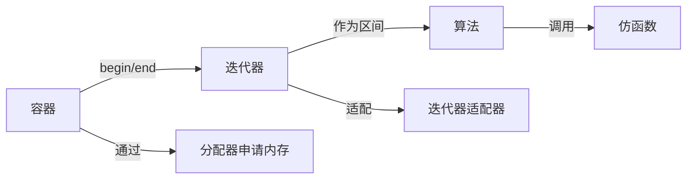
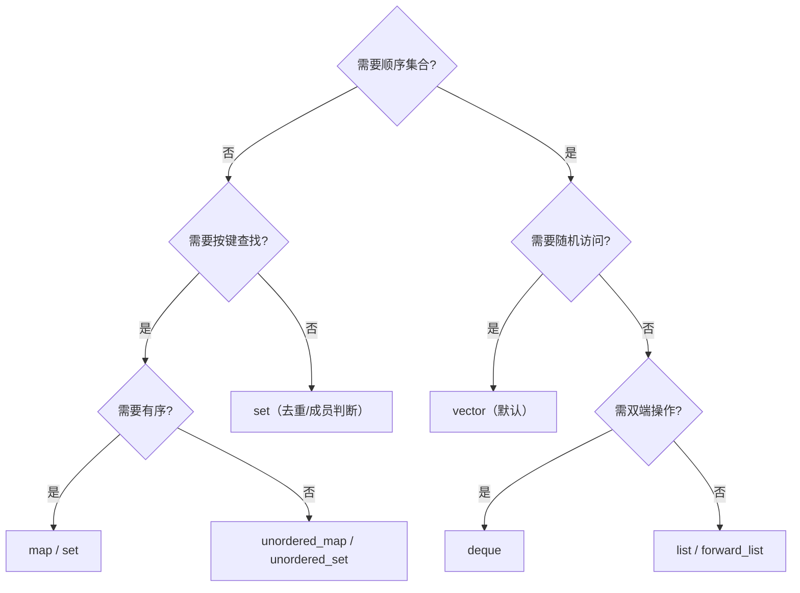

# STL 六大组件全详解

> STL（Standard Template Library，标准模板库）是 C++ 标准库中最具价值的泛型组件集。六大组件——**容器、算法、迭代器、仿函数、适配器、分配器**——相互协作，形成“算法不感知容器、容器不感知算法、通过迭代器解耦”的架构。本文件以**工具书查阅属性**为标准编写，严格限定在 C++11 及之前标准。

---

## 目录

1. 六大组件总览与协作模型
2. 容器全景：分类与底层结构
3. 序列容器详解：`vector` / `deque` / `list` / `forward_list` / `array`
4. 关联容器详解：`set` / `map` / `multiset` / `multimap`
5. 无序容器详解（C++11）：`unordered_*`
6. 容器适配器：`stack` / `queue` / `priority_queue`
7. 容器成员函数速查与横向对比
8. 迭代器体系
9. 算法库详解与分类
10. 仿函数（函数对象）与 `std::function`
11. 适配器（container/iterator/function 三系）
12. 分配器（allocator）
13. 字符串 `std::basic_string` 专项（STL 家族）
14. 工程选型指南与陷阱

---

## 1. 六大组件总览与协作模型

| 组件 | 角色 | 头文件族 |
|---|---|---|
| 容器（container） | 存储对象，管理生命周期 | `<vector>` `<deque>` `<list>` `<set>` `<map>` `<unordered_*>` |
| 算法（algorithm） | 对迭代器区间执行操作 | `<algorithm>` `<numeric>` |
| 迭代器（iterator） | 容器与算法之间的抽象指针 | `<iterator>` |
| 仿函数（functor） | 可调用对象，作为算法参数 | `<functional>` |
| 适配器（adapter） | 包装以改变接口 | `<stack>` `<queue>` `<functional>` `<iterator>` |
| 分配器（allocator） | 抽象内存分配 | `<memory>` |



**核心协作机制**：容器通过 `begin()/end()` 暴露迭代器区间，算法只依赖迭代器接口（`*`、`++`、`==`）操作区间，完全不知道底层容器类型。这种解耦使同一算法可作用于所有容器。

---

## 2. 容器全景：分类与底层结构

### 2.1 按底层结构分类

| 分类 | 容器 | 底层结构 | 特点 |
|---|---|---|---|
| 连续存储序列 | `vector` | 动态数组 | 随机访问 O(1)，尾插 O(1) 摊还 |
| 连续存储双端 | `deque` | 分段连续缓冲区 | 头尾插 O(1)，随机访问 O(1) |
| 链式序列 | `list` | 双向链表 | 任意位置插入 O(1)，无随机访问 |
| 单向链式 | `forward_list` | 单向链表 | 前向遍历，极省内存 |
| 定长数组 | `array`（C++11） | 栈上定长数组 | 零开销、固定大小 |
| 有序关联 | `set/map/multiset/multimap` | 红黑树（平衡二叉搜索树） | 有序、对数复杂度 |
| 哈希关联 | `unordered_*`（C++11） | 哈希表（开链） | 平均 O(1) 查找 |
| 适配器 | `stack/queue/priority_queue` | 底层默认 `deque/vector` | 接口受限 |

### 2.2 复杂度速查

| 操作 | vector | deque | list | set/map | unordered_set/map |
|---|---|---|---|---|---|
| 随机访问 | **O(1)** | O(1) | O(n) | O(n)（迭代） | O(n)（迭代） |
| 头插 | O(n) | **O(1)** | **O(1)** | O(log n) | O(1) 平均 |
| 尾插 | **O(1)** 摊还 | **O(1)** | **O(1)** | O(log n) | O(1) 平均 |
| 查找 | O(n) | O(n) | O(n) | **O(log n)** | **O(1)** 平均 |
| 插入（任意） | O(n) | O(n) | **O(1)**（已知位置） | O(log n) | O(1) 平均 |

---

## 3. 序列容器详解

### 3.1 `std::vector` — 动态数组（最常用）

**定位**：连续内存的动态数组；随机访问最快，尾插高效，是**默认首选容器**。
**底层结构**：连续存储的指针 `T* data_` + `size_` + `capacity_`。容量不足时**扩容**（通常 1.5~2 倍，重新分配并搬移/移动元素，迭代器失效）。
**适用场景**：需要随机访问、尾部增减、缓存局部性要求高的场合。
**优点**：O(1) 随机访问、尾插摊还 O(1)、缓存友好、与 C 数组可互操作。
**缺点**：中部/头部插入删除 O(n)；扩容触发搬移与迭代器失效；对 `bool` 特化为位压缩（`vector<bool>`，行为特殊）。

#### 核心成员函数（高频优先，加粗为必记）

- **`push_back(const T&)` / `push_back(T&&)`**：尾部追加；容量不足时扩容。
- **`pop_back()`**：移除末尾元素（不缩容）。
- **`operator[](size_t)` / `at(size_t)`**：随机访问；`at` 带越界检查（抛 `out_of_range`），`[]` 不检查。
- **`size()` / `empty()` / `capacity()` / `reserve(size_t)`**：元素数/判空/容量/预分配。
- **`resize(size_t, const T&=T{})`**：调整大小（多于则填充，少于则截断）。
- **`begin() / end() / rbegin() / rend()` / `cbegin()` 等**：迭代器（const 版本 C++11）。
- `insert(pos, val)`：在迭代器位置插入（O(n)，使之后的迭代器失效）。
- `erase(pos)` / `erase(first,last)`：删除元素/区间（O(n)）。
- `clear()`：清空。
- `front()` / `back()`：首/尾元素引用。
- `assign(first,last)` / `assign(n,val)`：重新赋值。
- `swap(other)`：交换内容（O(1)，仅交换内部指针）。
- `data()`：返回底层连续缓冲区指针（C++11）。
- `shrink_to_fit()`：请求收缩容量到 size（非强制，C++11）。
- `emplace_back(args...)`：就地构造，避免临时对象拷贝/移动（C++11 重点）。
- `emplace(pos, args...)`：就地插入（C++11）。
- `get_allocator()`：返回分配器。

#### 扩容与迭代器失效

```cpp
std::vector<int> v;
v.reserve(10);                 // 预分配避免反复扩容
for (int i=0;i<10;++i) v.push_back(i);
auto it = v.begin();
v.push_back(11);               // 若发生扩容，it 全部失效
```

**失效规则**：插入/删除使插入点之后迭代器失效；扩容使**全部**迭代器失效；`swap` 不失效；`reserve` 超过容量使全部失效。

### 3.2 `std::deque` — 双端队列

**定位**：双端可高效插入删除的队列。
**底层结构**：分段连续缓冲区数组（`map` 指针数组指向各块），逻辑连续，支持 O(1) 随机访问。
**适用场景**：需要头尾两端高频操作（如滑动窗口、任务队列）。
**优点**：头尾插入删除均 O(1) 摊还；随机访问 O(1)；中部操作比 list 有缓存优势。
**缺点**：缓存局部性略差于 vector；单次访问多一层间接寻址；不保证元素连续（无法 `data()` 当数组用）。

#### 核心成员函数

- **`push_back` / `push_front` / `pop_back` / `pop_front`**：四向首尾操作（高频）。
- **`operator[]` / `at`**：随机访问。
- **`front()` / `back()`**：首尾引用。
- **`size() / empty()`**。
- `insert / erase / clear / resize / swap / emplace_*`：与 vector 类似。
- `shrink_to_fit()`（C++11）。
- **迭代器类型为随机访问迭代器**。

### 3.3 `std::list` — 双向链表

**定位**：任意位置 O(1) 插入删除的序列。
**底层结构**：双向链表节点，每个节点含 `prev`/`next` 指针 + 元素。
**适用场景**：需在迭代器位置反复插入/删除、且不常随机访问的场合（如 LRU 的移动、任务调度）。
**优点**：任意已知位置插入/删除 O(1)，迭代器在插入删除后不失效（指向被删元素的除外）。
**缺点**：无随机访问（`operator[]` 不存在）；缓存不友好；每元素额外两指针开销。

#### 核心成员函数

- **`push_back / push_front / pop_back / pop_front`**：四向操作。
- **`insert(pos, val)` / `erase(pos)` / `erase(first,last)`**：O(1)（已知位置）。
- **`front() / back()`**。
- **`splice(pos, other)` / `splice(pos, other, it)`**：把另一 list 的节点**搬移**过来（O(1)，不复制元素，核心特性）。
- **`remove(val)` / `remove_if(pred)`**：移除匹配元素（真删除，区别于 erase-remove）。
- **`unique()`**：去除相邻重复。
- **`merge(other)`**：合并两个已排序 list（O(n)）。
- **`sort()`**：稳定排序（专用，优于 std::sort 的迭代器要求）。
- **`reverse()`**：反转。
- `size()`（C++11 为 O(1)）、`empty()`、`clear()`、`resize()`、`swap()`。
- **迭代器类型为双向迭代器**。

### 3.4 `std::forward_list` — 单向链表（C++11）

**定位**：仅前向遍历、极省内存的序列。
**底层结构**：单向链表（每节点单指针）。
**适用场景**：内存极度敏感且仅需前向处理（如哈希桶链）。
**优点**：内存开销最小（单指针），头部操作 O(1)。
**缺点**：无 `size()`（遍历计算）、无双向遍历、插入删除需前驱（`insert_after`）。

#### 核心成员函数

- `push_front / pop_front / front`。
- **`insert_after(pos, val)` / `erase_after(pos)`**：在指定位置**之后**插入/删除（单向链特征）。
- `before_begin()`：返回“首元素前”迭代器，配合 `insert_after`。
- `remove / remove_if / unique / merge / sort / reverse`：与 list 类似。
- `emplace_after`、`splice_after`（C++11）。

### 3.5 `std::array` — 定长数组（C++11）

**定位**：固定大小、零开销的数组封装。
**底层结构**：编译器内建数组（`T elems[N]`），无堆分配。
**适用场景**：需要数组的随机访问 + 迭代器/算法支持，且大小编译期已知。
**优点**：无动态分配、无内存开销、可被算法库使用、不退化指针。
**缺点**：大小固定，不可扩缩。

#### 核心成员函数

- **`operator[] / at / front / back`**。
- **`size() / empty()`**（编译期常量）。
- `fill(val)`：全部填值。
- `swap(other)`。
- `data()`：底层指针。
- `begin/end` 等迭代器。

---

## 4. 关联容器详解（有序，红黑树）

共同底层：**红黑树**（自平衡二叉搜索树），保证有序与 O(log n) 增删查。key 必须支持 `operator<`（或提供比较器）。

### 4.1 `std::set<T>` — 有序集合

**定位**：唯一、有序元素的集合。
**核心成员函数**：
- **`insert(val)`**：返回 `pair<iterator,bool>`（bool 表示是否真正插入）。
- **`find(key)`**：O(log n) 查找，返回迭代器或 `end()`。
- **`count(key)`**：键计数（set 中为 0/1）。
- **`erase(key)` / `erase(iterator)`**：删除。
- **`lower_bound / upper_bound / equal_range`**：有序区间查找（二分）。
- `empty / size / clear / begin/end`。
- **`emplace(args)`**（C++11）：就地构造。
- 元素不可修改（`const`），因修改会破坏红黑树排序。

### 4.2 `std::map<K,V>` — 有序映射

**定位**：key→value 的有序映射，按 key 排序。
**核心成员函数**：
- **`operator[](key)`**：按 key 访问，不存在则**插入默认值**并返回引用（注意：`operator[]` 会插入）。
- **`at(key)`**：访问，不存在抛 `out_of_range`（C++11 新增，避免误插入）。
- **`insert({k,v})`** / `insert_or_assign`（C++17 才有，C++11 用 `operator[]`）。
- **`find(key)`**：返回迭代器或 `end()`。
- **`erase(key)`**。
- **`lower_bound / upper_bound / equal_range`**。
- `emplace / emplace_hint`（C++11）。
- 遍历按 key 升序；元素为 `pair<const K, V>`（key 不可改）。

### 4.3 `std::multiset<T>` / `std::multimap<K,V>` — 允许重复

- 允许重复 key；`count` 返回重复个数；`equal_range` 返回全部重复区间。
- 无 `operator[]`（multimap）——因为 key 不唯一。
- `insert` 直接插入，不返回“是否插入”。

### 4.4 自定义比较器

```cpp
std::set<int, std::greater<int>> s;                       // 降序
struct ByLen { bool operator()(const std::string& a, const std::string& b) const
               { return a.size() < b.size(); } };
std::map<std::string,int,ByLen> m;                        // 自定义排序
```

比较器必须提供**严格弱序**（严格全序 + 可传递）。

---

## 5. 无序容器详解（C++11，哈希表）

`unordered_set` / `unordered_map` / `unordered_multiset` / `unordered_multimap`。
**底层结构**：哈希表（桶数组 + 冲突链，开链法）。key 需要 **哈希函数** `std::hash<Key>` 与**相等判断** `operator==`。
**适用场景**：追求平均 O(1) 查找、不要求有序遍历。
**优点**：查找/插入平均 O(1)。
**缺点**：无序；最坏 O(n)（哈希冲突）；重哈希使迭代器失效；内存分布分散（缓存不友好）。

#### 核心成员函数

- 与对应有序容器**同名接口**：`insert / find / count / erase / at / operator[] / emplace`。
- **`bucket_count()`**：桶数。
- **`load_factor()`**：当前装载因子 = size/bucket_count。
- **`max_load_factor()`**：触发重哈希阈值（默认约 1.0）。
- **`rehash(n)`**：重设桶数；`reserve(n)`：预留容量避免重哈希。

```cpp
std::unordered_map<std::string,int> m;
m.reserve(1000);              // 预分配减少重哈希
m.max_load_factor(0.7);       // 降低装载因子提升查找
```

#### 自定义哈希

```cpp
struct KeyHash { size_t operator()(const Key& k) const { return /*hash*/; } };
std::unordered_set<Key, KeyHash> s;
```

---

## 6. 容器适配器：`stack` / `queue` / `priority_queue`

适配器包装底层容器，**只暴露受限接口**。

### 6.1 `std::stack<T>`（默认底层 `deque`）

- **`push(val)` / `pop()` / `top()` / `empty()` / `size()`**。
- LIFO（后进先出）。无迭代器。

### 6.2 `std::queue<T>`（默认底层 `deque`）

- **`push(val)` / `pop()` / `front()` / `back()` / `empty()` / `size()`**。
- FIFO（先进先出）。无迭代器。

### 6.3 `std::priority_queue<T>`（默认底层 `vector`，堆）

- **`push(val)` / `pop()` / `top()` / `empty()` / `size()`**。
- 底层为二叉堆；`top()` 返回最大值（默认 `less`）。
- 无 `front/back` 顺序接口；无迭代器。

```cpp
std::priority_queue<int> pq;                 // 大顶堆
std::priority_queue<int, std::vector<int>,
                    std::greater<int>> pq2;  // 小顶堆
pq.push(3); pq.push(1); pq.push(2);
pq.top();   // 3
```

自定义比较器注意：`priority_queue` 的比较器语义是“决定谁排在后面”，与 `std::sort` 相反，易混淆。

---

## 7. 容器成员函数速查与横向对比

### 7.1 `vector` vs `deque` vs `list`（序列三强）

| 维度 | vector | deque | list |
|---|---|---|---|
| 随机访问 | **O(1)** | O(1) | 无 |
| 尾插 | O(1) 摊还 | O(1) | O(1) |
| 头插 | O(n) | **O(1)** | **O(1)** |
| 中部插入 | O(n) | O(n) | **O(1)**（已知位置） |
| 内存 | 连续，紧凑 | 分段连续 | 节点分散，指针开销 |
| 迭代器失效（插入） | 扩容全失效 | 不一定（除首尾） | 不失效 |
| 首选场景 | 随机访问+尾操作 | 双端队列 | 中部频繁插入/拼接 |

**选型结论**：
- 默认 `vector`。
- 需高频头部操作 → `deque`。
- 需在已持有迭代器处反复插入删除 → `list`。
- 需极省内存前向遍历 → `forward_list`。

### 7.2 `map` vs `unordered_map`（关联两强）

| 维度 | map（红黑树） | unordered_map（哈希） |
|---|---|---|
| 查找 | **O(log n)** | O(1) 平均 / O(n) 最坏 |
| 顺序 | **有序（按 key）** | 无序 |
| key 要求 | `operator<` | `std::hash` + `==` |
| 内存 | 节点分散 | 桶+节点，负载高时重哈希 |
| 迭代稳定性 | 插入删除不影响迭代器 | 重哈希使迭代器失效 |
| 适用 | 需要范围查询/有序遍历 | 仅按键查找、量大 |

**选型结论**：需要有序遍历、范围查询、lower_bound → `map`；只需按键存取、量大数据 → `unordered_map`。

### 7.3 set vs unordered_set

规则同上：是否要求有序唯一性决定选择。`set` 有 `lower_bound` 等有序操作，`unordered_set` 没有。

---

## 8. 迭代器体系

### 8.1 迭代器分类（按能力递增）

| 类别 | 能力 | 支持容器/工具 |
|---|---|---|
| 输入迭代器 | 只读、单向 | istream_iterator |
| 输出迭代器 | 只写、单向 | ostream_iterator、back_inserter |
| 前向迭代器 | 读写、单向、可复制 | forward_list、unordered_* |
| 双向迭代器 | 前向+反向 | list、set、map |
| 随机访问迭代器 | 双向+`+n`/`-n`/`[]`/比较 | vector、deque、array |

**指针满足随机访问迭代器全部要求**。

### 8.2 迭代器类型查询（C++11）

```cpp
#include <iterator>
std::iterator_traits<It>::iterator_category   // 类别
::value_type                                  // 元素类型
::difference_type                             // 差值类型
```

### 8.3 常用迭代器适配器

- `std::back_inserter(cont)`：输出迭代器，`operator=` 转为 `push_back`。
- `std::front_inserter(cont)`：`push_front`。
- `std::inserter(cont, pos)`：在 pos 处 insert。
- `std::istream_iterator<T>` / `std::ostream_iterator<T>`：流读写。

```cpp
std::vector<int> v;
std::copy(src.begin(), src.end(), std::back_inserter(v));   // 追加拷贝
std::copy(v.begin(), v.end(), std::ostream_iterator<int>(std::cout, " "));
```

### 8.4 失效规则总纲

| 操作 | 失效对象 |
|---|---|
| vector 扩容 | 全部迭代器 |
| vector 中部插入/删除 | 插入点之后全部 |
| deque 首尾操作 | 指向被删元素者；中部插入使全部失效（可能） |
| list/forward_list 插入 | 仅被删元素迭代器失效 |
| set/map 插入删除 | 仅被删元素迭代器失效 |
| unordered 重哈希 | 全部迭代器失效 |

**原则**：持有迭代器做修改操作时，使用返回值重新获取位置，勿复用旧迭代器。

---

## 9. 算法库详解与分类

头文件 `<algorithm>`（核心）、`<numeric>`（数值）、`<cstdlib>`（qsort/bsearch）。

### 9.1 分类总览

| 类别 | 代表算法 |
|---|---|
| 只读 | `find`、`count`、`find_if`、`count_if`、`for_each`、`all_of/any_of/none_of`(C++11) |
| 修改 | `copy`、`fill`、`transform`、`replace`、`reverse`、`rotate` |
| 排序 | `sort`、`stable_sort`、`partial_sort`、`nth_element` |
| 二分查找 | `lower_bound`、`upper_bound`、`binary_search`、`equal_range` |
| 堆 | `make_heap`、`push_heap`、`pop_heap`、`sort_heap` |
| 集合 | `set_union`、`set_intersection`、`set_difference` |
| 最值/数值 | `min`、`max`、`minmax`(C++11)、`accumulate`、`inner_product` |
| 其他 | `unique`、`remove`、`merge`、`next_permutation`、`swap` |

### 9.2 高频算法要点

#### `sort`
```cpp
std::sort(v.begin(), v.end());                    // 不稳定，平均 O(n log n)
std::sort(v.begin(), v.end(), std::greater<int>()); // 降序
```
- 需要稳定排序用 `std::stable_sort`。
- 只需求前 k 大/第 k 大用 `nth_element`（O(n)）。

#### `remove` / `erase` 惯用法（erase-remove）
```cpp
v.erase(std::remove(v.begin(), v.end(), target), v.end());
```
`remove` 把不匹配元素移到前面并返回新逻辑末尾，**不删除**（容器大小不变）；需配合 `erase` 真正移除。

#### `find` vs `lower_bound`
- `find`：线性 O(n)，适用于未排序/无序。
- `lower_bound`：二分 O(log n)，**要求区间有序**。

#### 谓词驱动的算法
```cpp
auto it = std::find_if(v.begin(), v.end(), [](int x){ return x > 100; });
```

#### `transform` / `accumulate`（map / fold）
```cpp
std::transform(src.begin(), src.end(), dst.begin(), [](int x){ return x*x; });
int sum = std::accumulate(v.begin(), v.end(), 0);       // 求和
int prod = std::accumulate(v.begin(), v.end(), 1,
                           std::multiplies<int>());     // 求积
```

### 9.3 算法对迭代器类别的依赖

- `sort` 需要随机访问迭代器。
- `reverse` 需要双向迭代器。
- `for_each`/`find` 只需输入迭代器（适用面最广）。

---

## 10. 仿函数（函数对象）与 `std::function`

- 仿函数 = 重载 `operator()` 的对象，可携带状态、可内联，作为算法谓词/比较器。
- `<functional>` 提供内建仿函数：`std::less`、`std::greater`、`std::plus`、`std::equal_to`、`std::logical_and` 等。
- `std::function`：类型擦除任意可调用对象（详见 `函数式编程思想.md`）。
- C++11 起，Lambda 是更简洁的仿函数写法。

---

## 11. 适配器（container / iterator / function 三系）

| 适配器 | 作用 |
|---|---|
| 容器适配器 | `stack`/`queue`/`priority_queue`：包装底层容器、限制接口 |
| 迭代器适配器 | `reverse_iterator`、`back_inserter`、`istream_iterator` 等：改变迭代语义 |
| 函数适配器 | `std::bind`、`std::mem_fn`：绑定/变换可调用对象 |

- 反向迭代：`rbegin()/rend()`（内部为 `reverse_iterator`）。
- 函数适配 C++11 优先用 Lambda 而非 `std::bind`。

---

## 12. 分配器（allocator）

**定位**：抽象“内存分配/释放”策略，容器默认使用 `std::allocator<T>`。
**作用**：使容器与具体分配策略解耦（池化、线程局部、审计分配等）。

```cpp
template <typename T>
struct MyAlloc {
    typedef T value_type;
    T* allocate(std::size_t n) { return static_cast<T*>(::operator new(n * sizeof(T))); }
    void deallocate(T* p, std::size_t n) { ::operator delete(p); }
    // 兼容：rebind、construct/destroy（C++11 起 construct/destroy 可省略）
};
std::vector<int, MyAlloc<int>> v;
```

要点：
- 现代 C++ 通常**不需要**自定义分配器（C++11 的 `scoped_allocator` 也未强制要求）。
- 池化分配器 / 对齐分配器是主要应用。
- C++11 标准改进了 allocator 的 minimum interface（`allocate/deallocate` 即可）。

---

## 13. 字符串 `std::basic_string` 专项

`std::string` = `std::basic_string<char>`。本质是**连续存储的动态字符串容器**（类似 vector<char>），拥有序列容器能力 + 字符串专属接口。

#### 核心成员函数（高频优先）

- **`size() / length() / empty()`**：长度/判空（O(1)）。
- **`operator[] / at`**：字符访问。
- **`append(...)` / `operator+=`**：追加。
- **`find(...)` / `rfind`**：子串/字符查找，返回位置或 `npos`。
- **`substr(pos, len)`**：取子串。
- **`compare(...)`**：比较。
- **`c_str()` / `data()`**：返回 `const char*`（`c_str` 保证 `\0` 结尾；C++11 起 `data` 同样 `\0` 结尾）。
- `replace`、`insert`、`erase`、`clear`、`resize`、`reserve`、`swap`。
- `stoi / stol / stof / to_string`（C++11 数值转换，见常用标准库章节）。
- `push_back`、`pop_back`、`front`、`back`（C++11 起与序列容器对齐）。
- 迭代器：随机访问迭代器，支持算法与范围 for。

> 字符串详细接口见 `C++常用标准库详解.md` 的 `<string>` 部分。

---

## 14. 工程选型指南与陷阱

### 14.1 选型决策流



### 14.2 高频陷阱清单

| 陷阱 | 说明 | 对策 |
|---|---|---|
| `vector` 迭代器失效 | 扩容/中部修改后复用旧迭代器 | 用返回值，勿复用 |
| `map::operator[]` 误插入 | 只读时用 `[]` 会插入默认值 | 用 `find`/`at` |
| `remove` 未 `erase` | 大小不变、尾部残留 | erase-remove 惯用法 |
| `sort` 不稳定 | 需稳定用 `stable_sort` |
| 迭代器越界 | 循环中 erase 使迭代器失效 | 用 `it = c.erase(it)` |
| 关联容器比较器错误 | 非严格弱序导致 UB | 确保严格弱序 |
| `unordered` 未预留 | 频繁重哈希性能骤降 | `reserve`/`max_load_factor` |
| `vector<bool>` 特殊 | 位压缩，`&v[0]` 非法 | 用 `vector<char>`/位集 |
| 大对象频繁拷贝 | 插入临时对象 | `emplace_back`/移动 |

---

> **进入下一章前自检**：能否对比 vector/deque/list 的选型？解释 erase-remove 惯用法？说明 map 与 unordered_map 的底层与适用差异？下一步请阅读 `C++常用标准库详解.md`。
