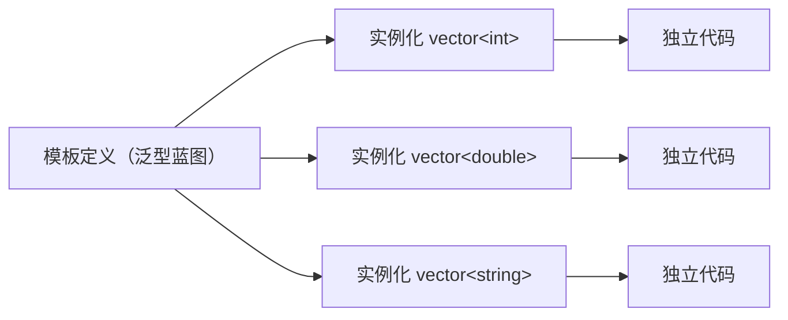

# 模板与泛型编程思想

> 泛型编程（Generic Programming）是 C++ 的核心设计哲学之一：**用类型参数化算法与数据结构，在编译期生成具体实例**，实现“一次编写、多类型复用、零抽象开销”。本文件严格限定在 C++11 及之前标准，覆盖函数模板、类模板、特化、变参模板、SFINAE、类型萃取等全部核心机制。

---

## 目录

1. 泛型编程思想与模板本质
2. 函数模板
3. 类模板
4. 模板实参推导
5. 模板特化与偏特化
6. 变参模板（C++11）
7. 完美转发与 `std::forward`（C++11）
8. 类型萃取 `<type_traits>`（C++11）
9. SFINAE 与高级技巧
10. 模板与编译期计算的边界
11. 模板工程实践与陷阱

---

## 1. 泛型编程思想与模板本质

### 1.1 思想定位

泛型编程让算法与容器**不依赖具体类型**，通过类型约束抽象出“算法对类型的最小要求”。典型体现：

- STL 算法（`sort`、`find`、`copy`）通过迭代器接口操作任意容器。
- 标准库容器（`vector<T>`、`map<K,V>`）通过类型参数化复用同一套实现逻辑。

### 1.2 模板的本质：编译期代码生成

模板不是运行期实体，而是**蓝图（blueprint）**。编译器在实例化（instantiation）时，用具体类型替换类型参数，生成一份独立的函数/类实体。例如 `vector<int>` 与 `vector<double>` 是完全不同的类型、完全独立的代码副本。



- **零抽象开销**：模板实例化在编译期完成，运行期无虚表、无装箱，性能等同手写专用代码。
- **代价**：编译时间与二进制体积增大；错误信息往往冗长难读。

---

## 2. 函数模板

### 2.1 基础形态

```cpp
template <typename T>
T max_of(T a, T b) {
    return a < b ? b : a;
}
```

调用时类型可推导（`max_of(3, 5)` → `T=int`）或显式指定（`max_of<double>(3.0, 5)`）。

### 2.2 多类型参数与返回类型

```cpp
template <typename T, typename U>
auto add(T a, U b) -> decltype(a + b) {   // C++11 尾置返回，推导表达式类型
    return a + b;
}
```

### 2.3 非类型模板参数

模板参数可为**编译期常量**（整数、枚举、指针、引用）：

```cpp
template <typename T, size_t N>
T sum(const T (&arr)[N]) { T s{}; for (auto v : arr) s += v; return s; }
```

### 2.4 重载与模板的交互

- 模板可与普通函数重载共存；重载决议时非模板函数优先（若精确匹配）。
- 多个模板候选按**偏序（partial ordering）**选择更特化者。
- 相同名字的模板函数体不同，可针对特定类型做重载以优化路径。

---

## 3. 类模板

### 3.1 基础形态

```cpp
template <typename T>
class Stack {
public:
    void push(const T& v) { data_.push_back(v); }
    T pop() { T v = data_.back(); data_.pop_back(); return v; }
private:
    std::vector<T> data_;
};
```

类模板的成员函数可以放在类外定义，须重复 `template` 头：

```cpp
template <typename T>
void Stack<T>::push(const T& v) { data_.push_back(v); }
```

### 3.2 类模板的成员模板

```cpp
template <typename T>
class Wrapper {
public:
    template <typename U>
    Wrapper(const Wrapper<U>& other);   // 成员模板：支持从 U 容器拷贝
};
```

成员模板允许类模板内部再定义独立于外层参数的类型参数。

### 3.3 嵌套与依赖名

- 依赖类型（dependent type）访问须加 `typename`：

```cpp
template <typename T>
void f() {
    typename T::iterator it;   // T::iterator 是依赖类型，必须 typename
}
```

- 依赖模板成员调用须加 `template` 关键字：

```cpp
template <typename T>
void g(T& t) {
    t.template call<42>();     // call 是依赖模板成员
}
```

---

## 4. 模板实参推导

编译器从实参推导模板参数，主要规则：

- **引用折叠（C++11）**：`T&&` 作为模板参数时，实参为左值则 `T` 推导为 `T&`（左值引用），实参为右值则 `T` 推导为 `T`（值/右值引用）。这是**通用引用（forwarding reference）**的基础。

```cpp
template <typename T> void pass(T&& t);   // T&& 是通用引用（非 const）
int x; pass(x);        // T = int&
pass(5);               // T = int
```

- **按值推导**时顶层 `const`/引用被剥离；**按引用推导**时保留 `const`。
- 数组与函数在按值推导时退化为指针；按引用推导时保留数组类型。
- `auto` 使用同一套推导规则（`auto&&` 亦为通用引用）。

---

## 5. 模板特化与偏特化

### 5.1 全特化（explicit specialization）

针对**特定类型**提供完全不同的实现：

```cpp
template <typename T> struct IsVoid { static const bool value = false; };
template <> struct IsVoid<void> { static const bool value = true; };
```

### 5.2 偏特化（partial specialization）

针对**部分类型类别**提供实现（仅类模板允许；函数模板不允许偏特化）：

```cpp
template <typename T> struct RemovePointer { using type = T; };
template <typename T> struct RemovePointer<T*> { using type = T; };  // 指针去一层
```

### 5.3 特化选择

编译器按最特化原则选择：全特化 > 偏特化 > 主模板。特化常用于：

- 特殊类型的性能路径（如 `vector<bool>` 位压缩）。
- 类型特性的分发（`std::hash`、`std::char_traits` 特化）。

---

## 6. 变参模板（C++11）

### 6.1 参数包

```cpp
template <typename... Args>
void print(Args... args);          // Args 是类型参数包
```

- `sizeof...(Args)`：包中元素个数（编译期）。
- `Args...` 在形参中展开为实际参数列表。

### 6.2 递归展开实现任意参数

```cpp
void print() {}                     // 终止递归的空版本
template <typename T, typename... Rest>
void print(T first, Rest... rest) {
    std::cout << first << ' ';
    print(rest...);                 // 递归展开
}
```

每次实例化剥离一个参数，直到命中空参数终止重载。

### 6.3 参数包的经典用途

- **完美转发封装**：`make_unique`、工厂函数、`std::bind` 等将实参原样转发给目标。

```cpp
template <typename T, typename... Args>
std::unique_ptr<T> make_unique(Args&&... args) {
    return std::unique_ptr<T>(new T(std::forward<Args>(args)...));
}
```

> 说明：标准库 `std::make_unique` 属 C++14，不在本文件范围。上例为 C++11 下**手写等价实现**，仅作完美转发范本；工程中若标准为 C++14+ 应直接用标准库版本。

- **元组实现**：`std::tuple<T...>` 内部即变参模板 + 递归继承。
- **类型列表**：模板元编程中用参数包表达类型集合。

---

## 7. 完美转发与 `std::forward`（C++11）

### 7.1 问题：参数类型在转发中丢失

```cpp
template <typename T> void wrap(T&& t) { inner(t); }   // t 是左值，右值性丢失
```

`t` 有名字即为左值；直接传给 `inner(t)` 会按左值处理，无法保留“实参是否为右值”。

### 7.2 `std::forward` 保留值类别

```cpp
template <typename T> void wrap(T&& t) {
    inner(std::forward<T>(t));    // 若实参是右值，则恢复为右值
}
```

- `std::forward<T>` 本质是**条件转换**：`T` 推导为左值引用则转左值，推导为值/右值引用则转右值。
- 通用引用 + `std::forward` 组合实现**完美转发**：既避免额外拷贝，又保留移动能力。

### 7.3 `std::move` 与 `std::forward` 的区别

| | 用途 | 行为 |
|---|---|---|
| `std::move(x)` | 无条件把 `x` 当右值 | 恒转换为右值引用 |
| `std::forward<T>(x)` | 模板中保留原值类别 | 按 `T` 是否引用决定转左/右值 |

---

## 8. 类型萃取 `<type_traits>`（C++11）

类型萃取是模板元编程的基础设施，编译期查询/变换类型属性。

### 8.1 主模板 + 特化实现

以 `remove_reference` 为例：

```cpp
template <typename T> struct remove_reference      { using type = T; };
template <typename T> struct remove_reference<T&>  { using type = T; };
template <typename T> struct remove_reference<T&&> { using type = T; };
```

### 8.2 常用类型萃取一览（C++11）

| 类别 | 典型成员 | 说明 |
|---|---|---|
| 类型查询 | `is_integral<T>`、`is_floating_point<T>`、`is_class<T>` | 编译期布尔 |
| 引用/指针 | `remove_reference<T>`、`remove_pointer<T>`、`decay<T>` | 去类型修饰 |
| 限定符 | `add_const<T>`、`remove_cv<T>` | 增删 `const`/`volatile` |
| 关系 | `is_same<T,U>`、`is_base_of<B,D>`、`is_convertible<From,To>` | 类型关系 |
| 可复制性 | `is_copy_constructible<T>` 等 | 能力查询 |
| 变换 | `conditional<bool,T,F>::type` | 编译期选择类型 |

### 8.3 便捷别名（C++14 引入，C++11 需写 `::type`）

```cpp
// C++11 写法
typename std::remove_reference<int&>::type x;   // int
```

### 8.4 `std::enable_if`（C++11）— 按条件启用

```cpp
template <typename T>
typename std::enable_if<std::is_integral<T>::value, T>::type
half(T v) { return v / 2; }
```

只有当 `is_integral<T>` 为真时该函数才参与重载，否则替换失败（SFINAE 静默移除）。

---

## 9. SFINAE 与高级技巧

### 9.1 SFINAE 原理

**SFINAE（Substitution Failure Is Not An Error，替换失败不是错误）**：在模板实参替换（substitution）过程中，若某候选因替换导致非法（如访问不存在成员），该候选被**静默从重载集合移除**，而非报编译错误——前提是失败发生在**函数签名**中而非函数体。

### 9.2 探测类型能力（detection idiom）

```cpp
template <typename T>
struct has_begin {
    template <typename U>
    static auto test(int) -> decltype(std::declval<U>().begin(), std::true_type{});
    template <typename>
    static std::false_type test(...);
    static const bool value = decltype(test<T>(0))::value;
};
```

利用 `decltype(std::declval<U>().begin())` 探测 `begin()` 是否存在；存在则匹配重载，否则落入 `...` 版本。

### 9.3 与 `decltype`、`declval` 配合

- `std::declval<T>()`（C++11）：在未构造对象的情况下取得 `T` 类型的“伪右值/伪左值”，用于 `decltype` 表达式。
- 上述组合是类型萃取、序列化框架、泛型库检测能力的常用手段。

---

## 10. 模板与编译期计算的边界

### 10.1 模板元编程（TMP）

模板特化 + 递归可在**编译期**完成计算：

```cpp
template <int N> struct Factorial {
    static const int value = N * Factorial<N-1>::value;
};
template <> struct Factorial<0> { static const int value = 1; };
// Factorial<5>::value == 120（编译期求得）
```

### 10.2 `constexpr` 的定位（C++11）

C++11 引入 `constexpr` 函数，允许更直观的编译期常量计算（函数体限定为单一 `return`）。相比手写 TMP，`constexpr` 语法更接近普通函数，是 TMP 的更现代替代方向（C++14 起进一步放开）。

### 10.3 编译期 vs 运行期边界

- 编译期：类型决策、常量计算、代码生成、约束检查。
- 运行期：数据依赖的动态逻辑、I/O、虚分派。
- 设计目标：把**能在编译期确定的事情尽量移到编译期**，获得正确性（类型约束）与性能（消除运行期检查）。

---

## 11. 模板工程实践与陷阱

### 11.1 模板定义的组织

- 模板的**声明与定义通常都放在头文件**中（两阶段查找限制，定义不可单独置于 `.cpp` 被他人包含）。
- 显式实例化（`template class Stack<int>;`）可将特定实例的定义放入 `.cpp`，减少编译时间与体积。

### 11.2 高频陷阱

| 陷阱 | 说明 | 对策 |
|---|---|---|
| 缺少 `typename` | 依赖类型前不写 `typename` 报错 | 规范书写 |
| 缺少 `template` | 依赖模板成员调用 | 加 `template` 关键字 |
| 参数推导二义 | 实参类型不一致（`max(1, 2.0)`） | 显式指定类型 |
| 实例化后才报错 | 类型不支持 `operator<` 等 | 用概念/静态断言提前约束 |
| 模板代码膨胀 | 每种类型一份代码 | 复用、特化热点 |
| 误用移动导致拷贝 | 转发未用 `std::forward` | 通用引用配合 `std::forward` |
| 递归无终止 | 变参展开无限递归 | 提供空参数重载终止 |

### 11.3 静态断言（C++11）

```cpp
static_assert(sizeof(int) >= 4, "int must be at least 4 bytes");   // 编译期检查
static_assert(std::is_trivially_copyable<T>::value, "T must be trivially copyable");
```

静态断言把类型/常量约束前置到编译期，是泛型代码质量的第一道闸门。

---

> **进入下一章前自检**：能否解释模板实例化与零抽象开销？`std::move` 与 `std::forward` 的区别？SFINAE 如何让“探测能力”成为可能？下一步请阅读 `函数式编程思想.md`。
