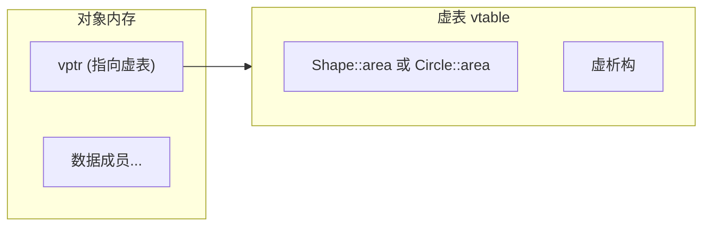

# 类和对象

> 本文件系统讲解 C++ 面向对象的核心机制：封装、构造/析构、拷贝与移动语义、继承、多态、虚机制与 RTTI。内容严格限定在 C++11 及之前标准。

---

## 目录

1. 类与对象的基本概念
2. 访问控制与封装
3. 构造函数体系（默认/重载/初始化列表/委托）
4. 析构函数与 RAII
5. 拷贝构造与拷贝赋值
6. 移动构造与移动赋值（C++11）
7. 运算符重载
8. 继承：公有/私有/保护继承
9. 虚函数与动态多态
10. 抽象类与接口
11. 静态成员与常量成员
12. 友元
13. 对象模型与虚表机制
14. 设计实践与陷阱

---

## 1. 类与对象的基本概念

**类（class）** 是一种用户自定义类型，将**数据成员**（状态）与**成员函数**（行为）封装为整体。**对象（object）** 是类的实例，拥有独立存储。

```cpp
class Counter {
public:
    void inc() { ++value_; }
    int get() const { return value_; }
private:
    int value_{0};        // C++11 类内初始化
};
Counter c;               // 对象
c.inc();
```

### 1.1 `struct` 与 `class`

- 两者仅默认访问级别不同：`struct` 默认 `public`，`class` 默认 `private`。
- 工程上 `struct` 多用于纯数据聚合（POD/聚合类型），`class` 用于带不变量与封装的类型。

### 1.2 对象布局

对象由数据成员按声明顺序（在满足对齐的前提下）连续排布，成员函数不占用对象存储。对象首地址对其内部最大对齐要求（`alignof`）。含虚函数的对象包含一个隐藏的**虚表指针 vptr**（见对象模型章节）。

---

## 2. 访问控制与封装

| 访问级别 | 类内 | 派生类 | 外部 |
|---|---|---|---|
| `public` | ✔ | ✔ | ✔ |
| `protected` | ✔ | ✔ | ✘ |
| `private` | ✔ | ✘ | ✘ |

**封装**的价值：将内部状态置于 `private`，只暴露受控接口，从而维持**类不变量**（invariant，如“余额非负”“链表节点数一致”）。直接暴露数据成员会破坏不变量并削弱演进自由度。

```cpp
class Account {
public:
    void deposit(int n) { if (n > 0) balance_ += n; }
private:
    int balance_{0};     // 不变量：balance_ >= 0
};
```

---

## 3. 构造函数体系

构造函数在对象存储分配后立即执行，负责建立初始状态。没有构造函数时，编译器生成**隐式默认构造函数**（仅当没有其他构造函数时才会生成）。

### 3.1 默认构造函数

```cpp
class S {
public:
    S() {}              // 显式默认构造
    S() = default;      // C++11：请求编译器生成默认版本
    S() = delete;       // C++11：删除（禁止默认构造）
};
```

- `= default` 保留平凡性（trivial），有利于 POD/布局稳定；`= delete` 用于禁止拷贝等。
- 若自定义了带参构造函数，默认构造函数**不会自动生成**，需显式提供或 `= default`。

### 3.2 初始化列表（member initializer list）

```cpp
class P {
public:
    P(double x, double y) : x_(x), y_(y) {}
private:
    double x_, y_;
};
```

- 初始化列表在进入构造函数体**之前**执行，直接构造成员（而非先默认构造再赋值）。
- 成员按**声明顺序**初始化，与列表书写顺序无关——列表书写顺序应与声明顺序一致，否则告警。
- 引用成员、`const` 成员必须在列表初始化；否则无法编译。

### 3.3 转换构造函数与 `explicit`

```cpp
class Number {
public:
    Number(int v) {}            // 隐式：int 可隐式转 Number
    explicit Number(double d){} // C++11：禁止隐式转换，须显式 Number(x)
};
```

- 单参非 `explicit` 构造函数定义从实参类型到类类型的**隐式转换**。
- 多态/容器等场景下隐式转换会引发意外调用，工程默认对单参构造函数加 `explicit`。

### 3.4 委托构造函数（C++11）

```cpp
class Config {
public:
    Config() : Config(80, "127.0.0.1") {}      // 委托到另一构造
    Config(int port, std::string host) : port_(port), host_(std::move(host)) {}
    // ...
};
```

一个构造函数可委托给同类另一构造函数，减少重复初始化逻辑。

### 3.5 移动/拷贝构造函数与三/五法则

- **C++98 三法则**：需要析构、拷贝构造、拷贝赋值三者之一，通常三者都要。
- **C++11 五法则**：新增移动构造、移动赋值。管理裸资源的类应实现完整五件套；否则通过移动/拷贝语义的正确组合维持资源安全。

---

## 4. 析构函数与 RAII

```cpp
class File {
public:
    explicit File(const char* p) : f_(fopen(p, "r")) {}
    ~File() { if (f_) fclose(f_); }   // 析构负责释放
private:
    FILE* f_;
};
```

**RAII（Resource Acquisition Is Initialization）**：把资源（内存、文件、锁、socket、句柄）的获取放在构造函数，释放放在析构函数。对象生命周期结束（离开作用域、异常栈展开、容器销毁）时析构必然执行，从而**自动、无泄漏、异常安全**地管理资源。

- 析构函数**不允许抛出异常**（抛出将导致 `std::terminate`）。
- 析构函数一般应声明 `noexcept`（C++11 中默认即 `noexcept`）。
- 若类的析构为私有（如单例对象），栈上不可构造该对象。

---

## 5. 拷贝构造与拷贝赋值

### 5.1 拷贝构造

```cpp
class Vec {
public:
    Vec(const Vec& other)              // 拷贝构造：由另一个对象构造
        : size_(other.size_), data_(new int[other.size_]) {
        std::copy(other.data_, other.data_+size_, data_);  // 深拷贝
    }
    // ...
private:
    size_t size_; int* data_;
};
```

### 5.2 拷贝赋值

```cpp
Vec& operator=(const Vec& other) {
    if (this == &other) return *this;      // 自赋值防护
    int* tmp = new int[other.size_];       // 先申请新资源
    std::copy(other.data_, other.data_+other.size_, tmp);
    delete[] data_;                        // 再释放旧资源
    data_ = tmp; size_ = other.size_;
    return *this;
}
```

关键点：**先建新、后删旧**，避免“自我赋值/异常中途”导致数据损坏；返回 `*this` 以支持链式赋值 `a = b = c`。

### 5.3 拷贝与传参返回

- 按值传参/返回触发拷贝（C++11 起可能被移动或拷贝省略取代）。
- 若类含裸指针/外部资源而不实现深拷贝，编译器生成的“浅拷贝”会导致**双重释放**或**悬垂**。

---

## 6. 移动构造与移动赋值（C++11）

```cpp
class Buffer {
public:
    Buffer(Buffer&& other) noexcept            // 移动构造
        : data_(other.data_), size_(other.size_) {
        other.data_ = nullptr; other.size_ = 0;   // 源置空
    }
    Buffer& operator=(Buffer&& other) noexcept {
        if (this != &other) {
            delete[] data_;
            data_ = other.data_; size_ = other.size_;
            other.data_ = nullptr; other.size_ = 0;
        }
        return *this;
    }
private:
    int* data_; size_t size_;
};
```

- 移动只“搬”所有权，不做深拷贝，显著降低临时对象拷贝开销。
- 参数为 `T&&`（右值引用）；源对象被移后必须处于**合法可析构/可赋值/可复用**状态。
- 应标记 `noexcept`，否则 `std::vector` 扩容时可能退回拷贝路径。
- `std::move` 只是无条件右值转换；`std::forward` 用于模板中的完美转发。

---

## 7. 运算符重载

运算符重载本质是“以运算符为名的成员函数或友元函数”，使自定义类型拥有与内置类型一致的语法。

### 7.1 常用重载形态

```cpp
class Complex {
public:
    Complex& operator+=(const Complex& o) { re_+=o.re_; im_+=o.im_; return *this; }
    friend Complex operator+(const Complex& a, const Complex& b);
private:
    double re_, im_;
};
Complex operator+(const Complex& a, const Complex& b) {
    return Complex(a.re_+b.re_, a.im_+b.im_);
}
```

### 7.2 关键重载清单

| 运算符 | 典型形态 | 注意 |
|---|---|---|
| 赋值 `=` | `T& operator=(const T&)` / `(T&&)` | 返回引用，防自赋值 |
| 复合赋值 `+=`等 | `T& operator+=(...)` | 返回 `*this` |
| 算术 `+ - * /` | `friend T operator+(...)` | 常为非成员 |
| 比较 `< > ==` | `bool operator<(const T&) const` | 为容器排序/查找服务 |
| 下标 `[]` | `T& operator[](size_t)` + `const` 版本 | 容器必要 |
| 函数调用 `()` | `Ret operator()(args)` | 仿函数（function object） |
| 流 `<< >>` | `friend ostream& operator<<(ostream&, const T&)` | 输入输出 |
| 解引用/箭头 `* ->` | 迭代器/智能指针 | 见 STL 章节 |
| `new/delete` | 类内重载 | 自定义分配器场景 |

### 7.3 约束与准则

- 不可重载：`.`、`::`、`?:`、`sizeof`、`typeid`、`.*`、`->*` 之外的大多数内置运算符**可以**，但仅限上述列出的不可重载项。
- 重载**不得改变**优先级、结合性、操作数个数。
- 保持语义一致（“`+` 就应可交换/可结合”），否则违背直觉。
- `operator<<`、`operator>>` 建议为**非成员友元**，使左操作数为 `std::ostream`。

---

## 8. 继承：公有/私有/保护继承

### 8.1 继承形态

```cpp
class Base { public: void f(); protected: int p_; private: int q_; };
class Derived : public Base { };      // is-a 关系
class Priv : private Base { };        // has-a 实现复用
class Prot : protected Base { };      // 中间层
```

| 继承方式 | 基类 public | 基类 protected | 基类 private |
|---|---|---|---|
| `public` | 保持 public | 保持 protected | 不可见 |
| `protected` | 变 protected | 保持 protected | 不可见 |
| `private` | 变 private | 变 private | 不可见 |

- **公有继承**表达“派生类是基类的一种”（is-a），用于多态。
- 私有/保护继承表达“复用基类实现”（has-a/implementation），不构成 is-a，外部不可见。

### 8.2 构造与析构顺序

- 构造：先基类 → 再成员 → 最后派生类自身构造函数体。
- 析构：严格相反（派生类 → 成员 → 基类）。
- 派生类构造函数必须显式（或默认）初始化直接基类；基类无默认构造时必须显式传参。

### 8.3 名称遮蔽（name hiding）与 `using` 提升

```cpp
class Derived : public Base {
public:
    using Base::f;            // 把基类被遮蔽的重载拉回派生类作用域
    void f(int);              // 遮蔽 Base::f() 的全部重载
};
```

派生类中声明同名函数会**遮蔽**基类所有重载；需用 `using Base::f` 恢复可见性。

### 8.4 覆盖与重载的区别

- **重载（overload）**：同作用域、同名、不同签名。
- **覆盖（override）**：派生类定义与基类虚函数**签名相同**的虚函数，实现多态。

---

## 9. 虚函数与动态多态

### 9.1 虚函数

```cpp
class Shape {
public:
    virtual double area() const { return 0; }
    virtual ~Shape() {}        // 多态基类必须有虚析构
};
class Circle : public Shape {
public:
    double area() const override { return pi_*r_*r_; }
};
```

- `virtual` 使调用按**对象动态类型**分派，而非编译期静态类型。
- `override`（C++11）：显式声明覆盖，签名不匹配时编译报错，防止“想覆盖却写错签名变成遮蔽”的静默错误。
- `final`（C++11）：类或虚函数不可再被继承/覆盖。
- **多态基类必须有虚析构函数**：否则 `delete base_ptr` 调不到派生类析构，导致资源泄漏（UB）。
- 虚函数调用经由虚表间接寻址，有轻微性能开销；热路径可用 `final` 与编译器去虚化优化。

### 9.2 纯虚函数与抽象类

```cpp
class Shape {
public:
    virtual double area() const = 0;   // 纯虚函数
    virtual ~Shape() {}
};
```

- 含纯虚函数的类是**抽象类**，不可实例化。
- 派生类实现全部纯虚函数后方可实例化；未全部实现仍是抽象类。
- 抽象类用作**接口契约**，是运行时多态与插件/策略模式的基础。

### 9.3 静态分派 vs 动态分派

| | 静态多态（模板） | 动态多态（虚函数） |
|---|---|---|
| 决议时机 | 编译期 | 运行期（vtable） |
| 开销 | 无间接调用 | 虚调用间接寻址 |
| 类型耦合 | 编译期已知 | 运行期对象 |
| 典型场景 | 泛型算法 | 接口抽象、插件 |

---

## 10. 抽象类与接口

“接口”在 C++ 中通常指**纯抽象类**：只含纯虚函数、无数据成员（或仅静态常量）的类。用于解耦实现与依赖。

```cpp
class ILogger {
public:
    virtual ~ILogger() = default;
    virtual void log(const std::string&) = 0;
};
```

- 面向接口编程：持有 `std::unique_ptr<ILogger>`，运行时注入具体实现（策略/依赖注入）。
- 与模板静态多态（CRTP，见模板章节）互补：需要运行期选择实现时用虚接口，编译期确定时用模板。

---

## 11. 静态成员与常量成员

### 11.1 静态成员变量

```cpp
class Widget {
public:
    static int count;      // 声明
};
int Widget::count = 0;     // 定义（一个程序一份，静态存储期）
```

- 静态成员属于**类**而非对象，所有对象共享一份。
- 类内 `static constexpr int n = 5;`（C++11）可类内定义常量，无需类外定义。

### 11.2 静态成员函数

```cpp
class Factory {
public:
    static Widget create() { return Widget(); }
};
```

静态成员函数没有 `this`，只能访问静态成员与其他静态函数；常用于工厂、单例、工具方法。

### 11.3 常量成员函数

```cpp
int get() const { return x_; }   // const 成员函数：承诺不修改对象
```

- `const` 限定出现在参数列表之后，作用于 `*this`。
- 可被 `const` 对象与 `const` 引用调用；非 `const` 版本不可被 `const` 对象调用。
- 通过 `mutable` 可修改特定成员（如缓存、统计计数）。

---

## 12. 友元

```cpp
class A {
    friend void inspect(const A&);   // 全局函数
    friend class B;                  // 整个类
    friend A operator+(const A&, const A&);
};
```

- 友元可访问类的 `private`/`protected` 成员。
- 常用于运算符重载（`operator<<`）、需要紧耦合的两个类（容器与迭代器）。
- **克制使用**：友元破坏封装边界，应仅在有明确理由（如运算符、类型间紧耦合）时使用。

---

## 13. 对象模型与虚表机制

> 更完整的内存布局分析见 `C++内存模型与对象模型.md`，此处给出与多态直接相关的虚机制要点。

### 13.1 虚表（vtable）与虚表指针（vptr）

- 含虚函数的类，其对象头部隐含一个 `vptr`，指向该类的虚表。
- 虚表是编译器生成的**函数指针数组**，按声明顺序存放该类每个虚函数的地址。
- 对象构造后 `vptr` 指向**自身动态类型**的虚表；派生类对象的虚表将基类虚函数地址替换为派生类覆盖版本。
- 虚调用 = 取对象 `vptr` → 查表 → 间接调用。



### 13.2 多继承与虚继承布局

- 多继承下对象包含**多个基类子对象**，多个 vptr，基类偏移由编译器计算（`this` 调整）。
- **菱形继承**（A←B、A←C、D←B,C）会产生两份 A 子对象；用**虚继承** `class B : virtual public A` 令 D 中只有一份 A。
- 虚继承的基类子对象通过虚基类指针/偏移表定位，布局更复杂、访问更慢，仅在确有需要时使用。

### 13.3 RTTI 与 `typeid` / `dynamic_cast`

```cpp
Shape* s = makeShape();
if (Circle* c = dynamic_cast<Circle*>(s)) { c->specific(); }
const std::type_info& t = typeid(*s);
```

- `dynamic_cast` 需要多态（含虚函数），运行时安全向下转型；失败返回 `nullptr`（指针）或抛 `std::bad_cast`（引用）。
- `typeid` 返回 `std::type_info`，需多态对象得到动态类型。
- 滥用 `dynamic_cast` 是设计缺陷信号（类型分支）；优先用虚函数多态表达差异。

---

## 14. 设计实践与陷阱

### 14.1 核心设计准则

| 准则 | 说明 |
|---|---|
| 单一职责 | 类只做一件事，理由唯一 |
| 最小暴露 | 成员私有，接口最小 |
| 深拷贝/移动语义 | 资源类实现五法则 |
| 多态基类虚析构 | 防资源泄漏 |
| 组合优于继承 | 优先包含对象而非继承 |
| 接口分离 | 用抽象类表达契约 |
| RAII 贯穿 | 一切资源用对象管理 |

### 14.2 高频陷阱

| 陷阱 | 后果 | 对策 |
|---|---|---|
| 基类缺虚析构 | `delete` 基类指针泄漏 | 多态基类加 `virtual ~T()` |
| 浅拷贝裸指针 | 双重释放/悬垂 | 深拷贝或智能指针 |
| 移动后仍使用源资源 | 逻辑错误 | 移动后置空源，约定合法状态 |
| 遮蔽而非覆盖 | 多态失效 | 加 `override` 编译器检查 |
| 虚函数构造期调用 | 调用基类版本（非多态） | 构造中避免虚调用 |
| 复制语义缺失 | 意外共享状态 | 显式 `delete` 拷贝或实现移动 |
| 静态成员忘定义 | 链接错误 | 类外 `int X::m = 0;` |
| 菱形继承重复基类 | 二义性/重复状态 | 虚继承 |

---

> **进入下一章前自检**：能否解释虚函数如何实现运行期多态？为何多态基类需要虚析构？能否写出带深拷贝与移动语义的资源类？下一步请阅读 `模板与泛型编程思想.md`。
