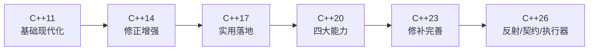

# C++26 新增特性

> C++26 是 C++ 标准化进入“两年一版”节奏后的首个版本，围绕**反射（reflection）**、**契约（contracts）**、**并发执行器（executors）** 三大方向推进，并伴随一批库修补。需要说明：C++26 的部分特性仍处于标准化过程（截至 2026 年为 C++26 冻结与实现落地期），本文按**已纳入 C++26 草案/已发布核心**整理。本文件逐条罗列，并为每个特性标注其在 C++11 基础模块中的出处。

---

## 目录

1. 反射（reflection）预览
2. 契约（contracts）
3. 并发执行器 `std::execution`（P2300）
4. 新增类型与库特性
5. 语法与关键字改进
6. 其他标准库增强
7. 与 C++11 联动总结

---

## 1. 反射（reflection）预览

**所属 C++11 模块**：`类和对象.md`（类/成员）、`C++内存模型与对象模型.md`（布局/RTTI）。

C++26 引入 **编译期反射**：以类型/表达式为对象进行查询与生成。核心是新的 `^`（反射运算符）与 `std::meta` 设施：

```cpp
#include <experimental/meta>   // 命名空间示意（标准化演进中）

// 查询类成员的名称与数量
constexpr auto members = std::meta::members_of(^MyStruct);
// 逐成员遍历、生成代码（宏/库生成成员名称、序列化、访问器）
```

- 反射在**编译期**求值，返回 `std::meta::info`（元数据句柄）。
- 可生成代码：自动序列化、成员访问、枚举遍历、类型到字符串。
- 重大影响：极大削减样板代码（序列化、ORM、反射式绑定），推动“代码生成”标准化。

**价值**：C++ 首次获得系统性反射能力，是现代 C++ 中最具前瞻性的特性。

---

## 2. 契约（contracts）

**所属 C++11 模块**：`C++核心语法详解.md`（异常处理/断言）、`模板与泛型编程思想.md`（静态断言）。

**前置/后置条件与断言**的语言级支持，编译期可检查、可关闭：

```cpp
int divide(int a, int b)
    [[pre: b != 0]]              // 前置条件
    [[post r: r >= 0]];          // 后置条件（r 为返回值）

void process(int n) [[assert: n > 0]];   // 断言
```

- 违约行为可在**编译期模式**下决定（关闭检查、抛异常、终止）。
- 让不变量/契约内嵌到接口，自文档化并可在调试/发布策略间切换。

**价值**：把运行时断言提升为语言级契约，增强接口自描述与错误定位能力。

---

## 3. 并发执行器 `std::execution`（P2300）

**所属 C++11 模块**：`C++并发编程.md`（任务/线程模型）。

**Sender/Receiver** 模型统一异步执行：把“异步任务”抽象为 **sender**，通过调度器（scheduler）提交，组成无堆栈的任务图：

```cpp
#include <execution>   // P2300 命名空间 std::execution

// 示意：在指定调度器上执行并链式组合
auto snd = stdexec::schedule(scheduler)
         | stdexec::then([] { return compute(); })
         | stdexec::then([] (int v) { return v * 2; });
stdexec::sync_wait(snd);    // 阻塞取最终结果
```

- **组合性**：多个异步操作通过管道链接成 DAG，无回调嵌套。
- 与协程互补：sender 面向**结构化并发/任务图**，协程面向**挂起恢复**。
- 目标是高性能计算、I/O 异步、跨调度器的统一抽象。

**价值**：为“高性能异步 + 结构化并发”提供标准执行模型，是并发编程的下一代接口。

---

## 4. 新增类型与库特性

### 4.1 `std::inplace_vector<T,N>`（`<inplace_vector>`）

**所属 C++11 模块**：`STL六大组件全详解.md`（`std::array`/`vector`）。

**定容量的动态 vector**：存储嵌入对象本身（栈/静态），容量编译期固定，但大小可动态变化：

```cpp
#include <inplace_vector>
std::inplace_vector<int, 8> v;   // 容量固定 8
v.push_back(1); v.push_back(2);  // 不会堆分配
// 超容量 push_back 抛 std::bad_alloc（容量固定）
```

**价值**：无堆分配、缓存友好的“小动态数组”，适合嵌入式与性能敏感路径。

### 4.2 `std::hive`（`<hive>`）

**所属 C++11 模块**：`STL六大组件全详解.md`（容器）。

**无稳定引用的高性能容器**：删除 O(1)、插入不影响既有元素，专为“大量对象增删、引用须稳定”设计：

```cpp
#include <hive>
std::hive<int> h;
auto it = h.emplace(42);
h.erase(it);                 // O(1)，其余元素引用稳定
```

**价值**：游戏/实体系统等“大量动态对象 + 稳定引用”场景的高效容器。

### 4.3 新 `std::format` 与字符串增强

- 更多 `std::format` 格式化扩展（错误类型、环境变量占位等）。
- `std::text_encoding`：文本编码类型。

---

## 5. 语法与关键字改进

| 语法 | 说明 |
|---|---|
| `static_assert` 无消息 | 简化（已有，持续兼容） |
| `std::no_unique_address` | 成员不强制占用地址（类优化，配合空成员压缩） |
| 可变长 Lambda/参数改进 | 语法补全 |
| `using enum` 进一步 | 枚举成员导入（C++20 已引入，持续扩展） |
| 折叠/概念细节 | 若干边界修补 |
| `[[nodiscard]]` 细化 | 更多上下文 |

```cpp
struct S {
    [[no_unique_address]] Empty e;   // 空成员不占独立地址
    int x;
};
```

---

## 6. 其他标准库增强

| 特性 | 说明 |
|---|---|
| `std::cmp_*` 比较增强 | 有符号/无符号安全比较 |
| `std::atomic` 更多类型 | `atomic<shared_ptr>`、浮点原子扩展 |
| `std::generator` 完善 | 协程生成器补强 |
| `std::ranges` 更多适配器 | `chunk_by`、`enumerate` 等 |
| `std::jthread`/`stop_token` 完善 | 协作式取消深化 |
| `std::mdspan` 布局扩展 | 更多布局与子视图 |
| 数值与数学增强 | 位、取整、误差函数等 |

```cpp
#include <utility>
std::cmp_less(a, b);   // 避免有符号/无符号混比较的隐患
```

---

## 7. 与 C++11 联动总结

| C++26 特性 | C++11 基础模块 | 联动理解 |
|---|---|---|
| 反射 | 类和对象 / 对象模型 | 编译期查询与生成 |
| 契约 | 核心语法（异常/断言） | 语言级不变量 |
| executors | 并发编程 | 结构化异步执行 |
| inplace_vector | STL（array/vector） | 定容量动态数组 |
| hive | STL（容器） | 稳定引用容器 |
| no_unique_address | 对象模型（对齐/布局） | 布局优化 |

---

## 附录：现代 C++ 版本演进速览



> 现代 C++ 篇章结束。接下来进入 `C++生态及工具链` 篇章，从语言本身走向工程工具链。
